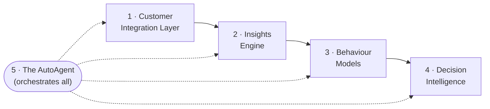

# AutoAgentAI

**AutoAgent and Customer-Integrated Custom Insights into Purchase and Overall Behaviour and Decision Making.**

[](https://nikhilprakash24.github.io/AutoAgentAI-consumerDataIntegrationAndCollection/)
[](./LICENSE)
[](./docs/roadmap.md)

> **What it is in one line:** an autonomous AI agent that unifies a business's
> customer data and continuously produces **custom insights** into how customers
> **buy**, **behave**, and **decide** — then surfaces or acts on those insights to
> improve decisions.

This repository is **documentation-first**. It captures the concept, architecture,
and design of AutoAgentAI in an organized, hosted form so the project can later
grow into formal specifications and an implementation.

---

## 📖 Read the docs

The documentation is browsable as a hosted site (GitHub Pages) and also reads
natively here on GitHub as markdown.

- **Hosted site:** https://nikhilprakash24.github.io/AutoAgentAI-consumerDataIntegrationAndCollection/ *(live once Pages is enabled)*
- **Start here:** [`docs/index.md`](./docs/index.md)

## 🧭 Documentation map

| Section | What it covers |
|---|---|
| [Vision](./docs/vision.md) | The title decoded, positioning, what success looks like |
| [Problem & Motivation](./docs/problem-motivation.md) | The pain, who it's for, why now |
| [Concepts & Glossary](./docs/concepts-glossary.md) | Shared vocabulary — AutoAgent, insight, behaviour, decision |
| [Architecture](./docs/architecture.md) | The five pillars and how they fit together |
| [Customer Integration](./docs/customer-integration.md) | Connecting and unifying customer data |
| [Insights Engine](./docs/insights-engine.md) | How custom, tailored insights are generated |
| [Behaviour Models](./docs/behaviour-models.md) | Modeling purchase and overall behaviour |
| [Decision Making](./docs/decision-making.md) | Turning insights into decisions and actions |
| [The AutoAgent Loop](./docs/agent-loop.md) | The autonomous perceive → reason → act → learn loop |
| [Use Cases](./docs/use-cases.md) | Concrete scenarios across industries |
| [Roadmap](./docs/roadmap.md) | Phases toward build and specs |
| [Specifications](./docs/specs/index.md) | Placeholder for future technical specs |
| [Figure Specs](./docs/assets/diagrams/FIGURE_SPECS.md) | Visual/diagram specs you can hand to an image generator |

## 🏗️ The five pillars



## 🖥️ Building the docs locally

```bash
pip install -r requirements.txt
mkdocs serve        # live preview at http://127.0.0.1:8000
mkdocs build        # static site into ./site
```

Pushing to `main` auto-builds and deploys the site via the workflow in
[`.github/workflows/deploy-docs.yml`](./.github/workflows/deploy-docs.yml).

## 🗂️ Status

**Concept & documentation.** No product code yet — this repo exists to get the
thinking organized and hosted so building and specs can follow. See the
[roadmap](./docs/roadmap.md).

## 📜 License

[MIT](./LICENSE) © 2026 Nikhil Prakash
