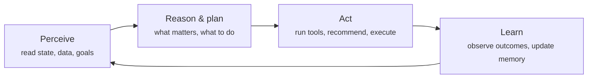
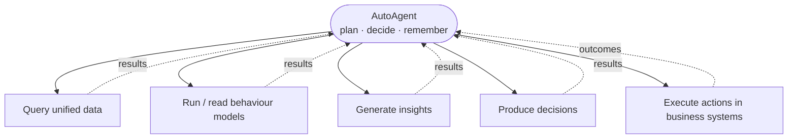
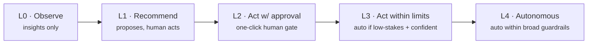

# The AutoAgent Loop

**Pillar 5.** The orchestrator that makes the system an *agent* rather than a
pipeline. It holds goals, decides what to do next, invokes the other pillars as
tools, remembers, and acts within guardrails.

## The loop

Unlike a dashboard that waits for a query, the AutoAgent runs this loop on its own
cadence — scheduled, event-triggered, or on demand — and chooses its own next
question.

### Perceive
Read current goals, recent data and events from the [integration
layer](customer-integration.md), outputs from the [behaviour
models](behaviour-models.md), and its own memory of what it has already done and
learned.

### Reason & plan
Decide what matters now and form a plan: which segments or customers to look at,
which [insights](insights-engine.md) to pursue, which [decisions](decision-making.md)
to prepare. This is where goals and priorities shape attention.

### Act
Invoke pillars 1–4 as **tools**, surface insights, propose or (within guardrails)
execute actions. Every act is recorded with its reasoning.

### Learn
Observe outcomes (via attribution), update memory and the sense of what works, and
feed results back to the models. The next loop is better-informed than the last.

## The agent as a tool-user

The AutoAgent doesn't reimplement the pillars — it *calls* them, plus the business's
systems, as tools:

## Memory

The agent is stateful. Memory makes it improve and keeps it from repeating itself:

| Memory type | Holds | Used for |
|---|---|---|
| **Working** | The current investigation's context | Completing the task at hand |
| **Episodic** | Past insights, actions, and their outcomes | Not re-surfacing known findings; learning what worked |
| **Semantic** | Durable knowledge about the business, its customers, and its goals | Grounding reasoning in context |

## Guardrails and autonomy levels

Autonomy is **configurable and graduated**. Guardrails define what the agent may do
on its own.

Typical guardrails:

- **Stakes & reversibility** — irreversible or high-cost actions require approval.
- **Confidence floors** — act only above a confidence threshold.
- **Budget & frequency caps** — spend and contact limits per customer/segment.
- **Excluded actions & audiences** — hard "never do this" rules.
- **Escalation** — anything outside the envelope is escalated to a human.

A business starts low (observe/recommend) and raises autonomy per action type as the
agent earns trust through its track record.

## Safety and accountability

- **Full audit trail** — every perception, decision, and action is logged with
  reasoning and provenance.
- **Explainability on demand** — any output can be traced back to its evidence.
- **Reversibility & kill-switch** — actions are reversible where possible, and the
  agent can be paused instantly.
- **Resistant to bad input** — the agent treats external/customer-supplied text as
  data, not instructions, and validates surprising signals before acting.

## Open questions (for specs)

- The agent framework / reasoning model and how planning is implemented.
- Cadence: schedule, event triggers, and how continuous "continuous" is.
- Exact memory representation and retention.
- Default guardrail envelopes shipped out of the box.
