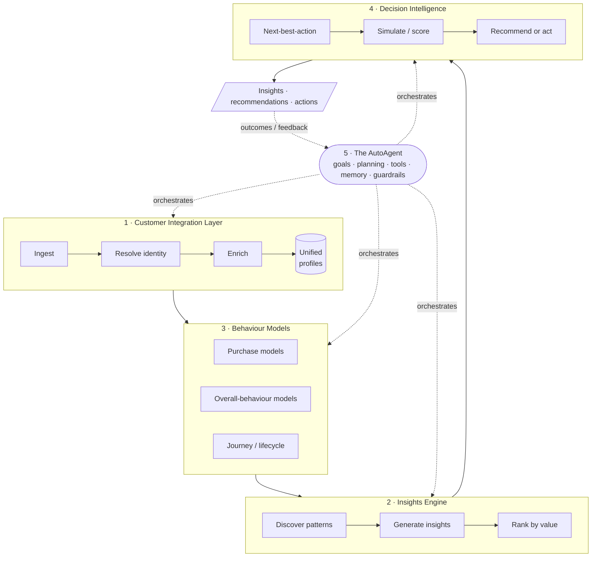
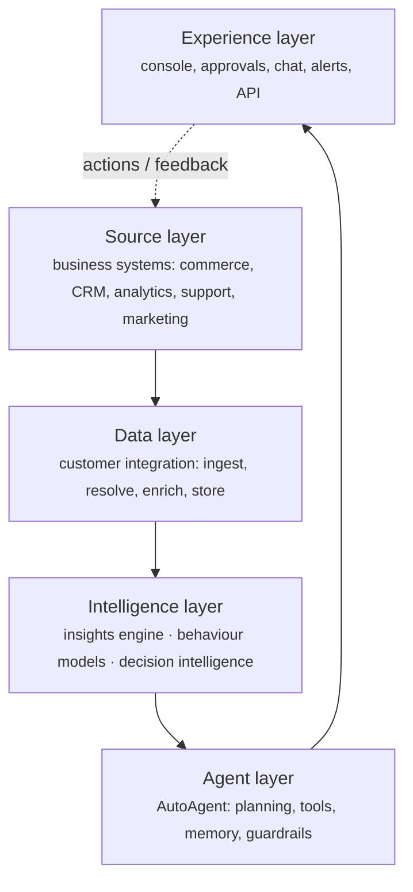
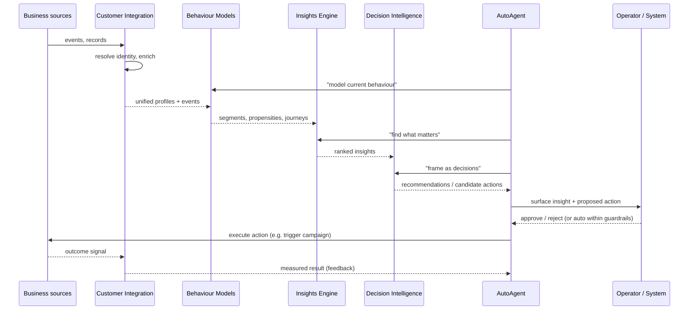

# Architecture

AutoAgentAI is organized into **five pillars**. Four are capabilities arranged as a
pipeline; the fifth — the AutoAgent — is the orchestrator that drives them, holds
goals and guardrails, and closes the loop with feedback.

## The pillars at a glance

| Pillar | Input | Output | Detailed page |
|---|---|---|---|
| **1 · Customer Integration Layer** | Raw data from business sources | Unified, enriched customer profiles + event history | [Customer Integration](customer-integration.md) |
| **2 · Insights Engine** | Profiles + model outputs | Ranked, grounded custom insights | [Insights Engine](insights-engine.md) |
| **3 · Behaviour Models** | Unified profiles + events | Segments, propensities, journeys | [Behaviour Models](behaviour-models.md) |
| **4 · Decision Intelligence** | Insights + model outputs | Recommendations and actions | [Decision Making](decision-making.md) |
| **5 · The AutoAgent** | Goals + everything above | Orchestration, autonomy, memory, audit | [The AutoAgent Loop](agent-loop.md) |

## Logical layers

A different cut of the same system — by layer rather than by pillar — useful when
thinking about where a given responsibility lives:

## Data flow (end to end)

## Cross-cutting concerns

These apply to every pillar and must be designed in, not bolted on:

- **Trust & provenance** — every insight and action carries a trace from raw data
  through reasoning to output, enabling explanation and audit.
- **Privacy & consent** — identity resolution and action-taking respect consent,
  data-minimization, and regional rules (e.g. GDPR/CCPA). Covered further in
  [Customer Integration](customer-integration.md#privacy-consent-and-trust).
- **Guardrails & autonomy level** — what the agent may do without approval is
  explicit and configurable. See [The AutoAgent Loop](agent-loop.md#guardrails-and-autonomy-levels).
- **Observability** — the system's own behaviour (what it looked at, decided, and
  did) is logged and measurable.
- **Extensibility** — new data sources, models, and action types plug in without
  reworking the core.

## Design stance (intentionally not yet decided)

This document describes the **logical** architecture. The **physical** choices —
languages, model providers, datastores, deployment — are deliberately deferred to
the [specifications](specs/index.md) so the concept isn't prematurely locked to a
stack. Where a choice is load-bearing, it will be recorded as a decision with
trade-offs when specs begin.
