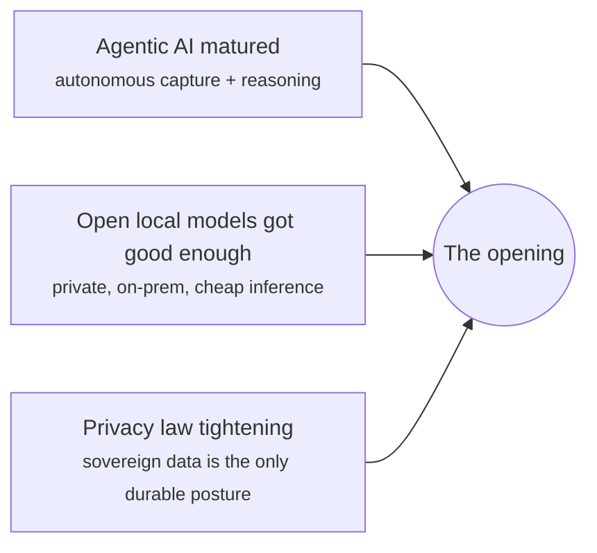
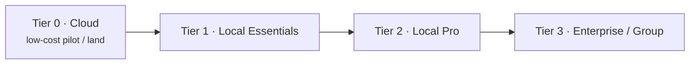

# AutoAgentAI — Investor Pitch

!!! abstract "The one-liner"
    AutoAgentAI is an autonomous AI agent that captures and uses the **most valuable,
    least-captured data in the car industry** — the buyer's real pre-purchase intent
    and decision behaviour — running **privately on-prem** so it clears the privacy
    bar that kills everyone else, and **closing the loop from the showroom floor all
    the way to the OEM.**

## The problem

The automotive purchase is one of the largest, most considered, most emotional
consumer decisions there is — and the data about *why* buyers choose, hesitate, and
walk is almost entirely **uncaptured**. Not under-captured: structurally
uncapturable, because the only people positioned to capture it — salespeople — can't
([why](../perspectives/why-salespeople-cant-capture-this.md)). The industry runs on
memory, sticky notes, lagging sales figures, and survey-with-a-prize-draw
guesswork.

## Why now

Three curves crossed at the same time:

For the first time it is possible to **capture** this data (agentic AI), **do it
privately** (local models on-prem), and **act on it** autonomously — all at once.
That simultaneity is the window.

## What it is

An autonomous agent across four capabilities — unify the dealership's customer data,
model behaviour, generate custom insights, and turn them into decisions and
actions — delivered through McDonald's-style kiosks and iPad nodes on the floor, and
running entirely on the dealership's own hardware.

See the [architecture](../architecture.md) and the
[raw-data-to-action scenario](../perspectives/raw-data-to-action.md).

## The wedge: the most valuable data in autos

Value = stakes × relationship length × decision-signal × scarcity × reach up the
chain. This data scores at the top of all five
([detail](../perspectives/how-valuable-this-data-is.md)):

- **Huge stakes per decision** — a vehicle, a trade-in, finance, years of service.
- **A lifelong, repeating relationship** — shop → buy → own → service → trade → repeat.
- **Genuine decision signal**, not vanity metrics.
- **Scarce** — basically nobody has it, because it was uncapturable.
- **Valuable at every level** — salesperson, dealer, group, and **OEM**.

## The moat

The AI is commodity. The moat is **capture + privacy + the loop**:

| Layer | Why it defends |
|---|---|
| **Data capture** | Being in every channel at once, capturing as a by-product — hard to replicate without the on-floor footprint |
| **On-prem/private** | The only posture that can legally hold this PII at scale as law tightens ([privacy](../deployment/privacy-pii-future-proofing.md)) |
| **The OEM loop** | Once aggregated buyer-intent flows to manufacturers and shapes product/pricing, it compounds and entrenches ([loop](../perspectives/automotive-data-closing-the-loop.md)) |
| **Data network effect** | Every interaction sharpens the models; more dealers → more signal → better product |

## Business model: four tiers as a pricing ladder

- **Land** with low-cost Tier 0 pilots to prove value fast.
- **Expand** to on-prem Tiers 1–3 (hardware + license/subscription) once proven — the
  identical workflows migrate with no rebuild.
- **Multiply** across a dealer group (Tier 3) and, longer term, **monetize the
  aggregated OEM feedback loop** — a second revenue surface the data unlocks.

Revenue surfaces: setup/hardware, recurring license per site/seat, group/enterprise
contracts, and OEM-facing insight products.

## Market

Tens of thousands of dealerships; a global new+used vehicle market measured in the
trillions; OEMs that spend heavily to *infer* buyer intent they could instead
measure. The beachhead is a single rooftop; the expansion is the group; the prize is
the loop to the manufacturer.

!!! note "On numbers"
    Market and revenue framing here is directional for positioning. A bottoms-up
    model (per-rooftop economics, attach rates, hardware vs. recurring split) is a
    fast-follow once a design-partner dealer is signed.

## Go-to-market

1. **Design-partner dealership** — Tier 0/1, prove conversion, trade-in capture, and
   retention lift against a holdout.
2. **Reference rooftop → group** — expand within the group on Tiers 2/3.
3. **OEM conversation** — bring aggregated, anonymized buyer-intent signal to the
   manufacturer; open the loop revenue.

## Roadmap & the ask

Today: concept and documentation complete ([roadmap](../roadmap.md)). Next:
specifications and a design-partner pilot. **The ask:** [capital / a design-partner
dealer / an OEM introduction — fill in per conversation] to fund Phase 1 (specs) and
a measured Tier-0/1 pilot that proves the lift and the loop.

!!! quote "Why we win"
    Everyone has an AI agent. We found the gold it's for — the car industry's most
    valuable data — and we're the only ones capturing it privately and closing the
    loop to the OEM. The technology is ordinary; the position is not.
