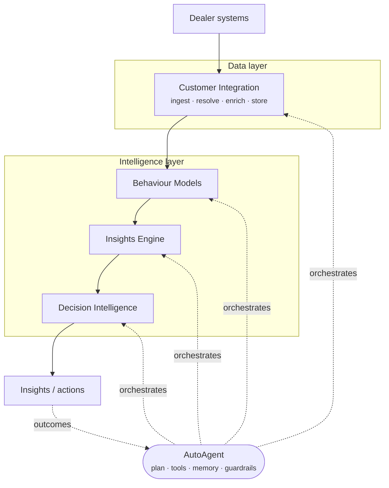
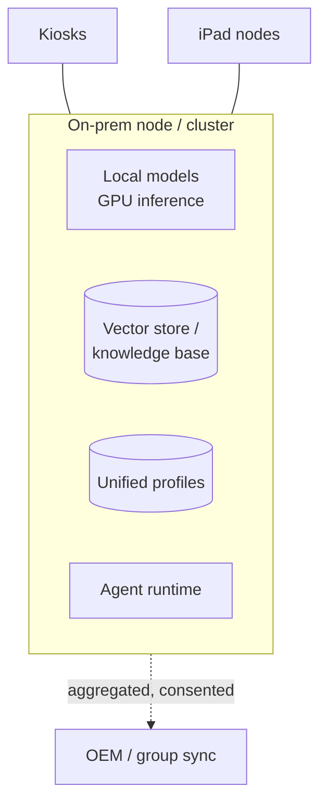

# AutoAgentAI — Technical Overview

A dense, engineer-facing tour for someone evaluating *how it's built* and *whether it
holds up*. For the full treatment, follow the links into the detailed docs.

!!! abstract "System in one sentence"
    A stateful, autonomous agent orchestrates four capability pillars — data
    integration, behaviour modeling, insight generation, and decision intelligence —
    over a dealership's unified customer data, running on local open-source models,
    on-prem, behind thin kiosk/iPad clients.

## Architecture

Four pillars in a pipeline, driven by a fifth (the agent). Full detail:
[Architecture](../architecture.md).

| Layer | Responsibility | Detail |
|---|---|---|
| Source | Dealer systems: DMS/CRM, web, service, finance | — |
| Data | Ingest, identity resolution, enrichment, unified profiles | [Customer Integration](../customer-integration.md) |
| Intelligence | Propensities, segments, insights, next-best-action | [Models](../behaviour-models.md) · [Insights](../insights-engine.md) · [Decisions](../decision-making.md) |
| Agent | Orchestration, memory, autonomy, audit | [Agent Loop](../agent-loop.md) |
| Experience | Kiosks, iPad nodes, approvals, chat, API | [Hardware](../deployment/on-prem-ai-hardware.md) |

## Deployment topology

Thin clients, intelligent core. Kiosks and iPads are **nodes**, not stores — models
and data stay on the on-prem box.

Four tiers scale the same stack from a single workstation (Tier 1) to a redundant
GPU cluster (Tier 3); Tier 0 is a cloud variant for non-sensitive pilots. See the
[tier matrix](../deployment/on-prem-ai-hardware.md#the-four-deployment-options).

## Local model strategy

Tasks are bounded — read, extract, classify, summarize, rank, draft — and
**retrieval-grounded** + **structured-output-constrained**, which is precisely where
open local models match cloud models. Rationale and limits:
[Local Models Are Enough](../deployment/local-models-are-enough.md).

- **Grounding:** RAG over the local knowledge base; the model reasons over supplied
  facts, not parametric memory.
- **Structure:** schema-constrained outputs (fill fields, pick from menus) over
  freeform generation.
- **Decomposition:** multi-step logic lives in the agent/tools, not one giant call;
  each inference is small and verifiable.
- **Economics:** fixed-cost inference enables a continuously-running loop without a
  per-call meter.

## Data model & identity

Conceptual model (physical schema deferred to [specs](../specs/index.md)): a
`Customer` with many `Identity`, `Event`, `Order`, `Interaction`, and `Feature`
records. Identity resolution is deterministic-first (strong keys), probabilistic with
confidence scoring for the rest, and **confidence-aware** (low-confidence links are
flagged, not silently merged). Detail: [Customer Integration](../customer-integration.md).

## Agent runtime

Perceive → reason/plan → act → learn, on its own cadence (scheduled + event-driven).
Three memory types (working, episodic, semantic). Tools = the four pillars + dealer
systems. Detail: [Agent Loop](../agent-loop.md).

## Security, privacy & guardrails

- **Data locality** is the primary control: on-prem means no third-party processors,
  no cross-border transfer, minimal breach surface ([privacy](../deployment/privacy-pii-future-proofing.md)).
- **Guardrails:** graduated autonomy L0–L4; confidence floors; budget/frequency caps;
  excluded actions; escalation.
- **Provenance:** every insight/action carries a trace (data → reasoning → output)
  for explainability and audit of automated decisions.
- **Safety:** reversible actions, kill-switch, external text treated as data not
  instructions.
- **Thin clients:** a lost iPad is a window, not a database copy.

## What's decided vs. deferred

| Decided (logical) | Deferred to Phase-1 specs (physical) |
|---|---|
| Five-pillar architecture; on-prem-first; thin clients | Concrete stack, languages, datastores |
| Local-model-first; retrieval-grounded; structured outputs | Specific model(s), GPU sizing, eval bar |
| Graduated autonomy + provenance | Default guardrail envelopes, action catalog v1 |
| Conceptual data model | Physical schema, ingestion (stream vs batch) |

Deliberately logical-first so the concept isn't prematurely locked to a stack; ADRs
capture load-bearing choices when specs begin. See [Specifications](../specs/index.md)
and the [Roadmap](../roadmap.md).

!!! note "Evaluation is a first-class Phase-1 deliverable"
    A task-level eval suite on real dealership data proves the chosen local model
    clears the quality bar before anything ships — the claim in
    [Local Models Are Enough](../deployment/local-models-are-enough.md) is to be
    *measured*, not asserted.
