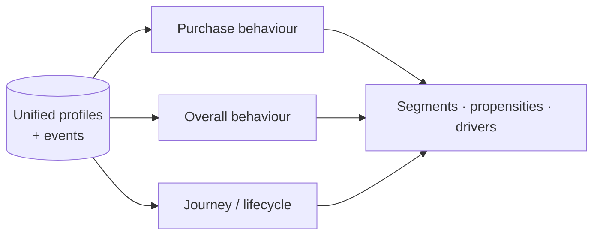
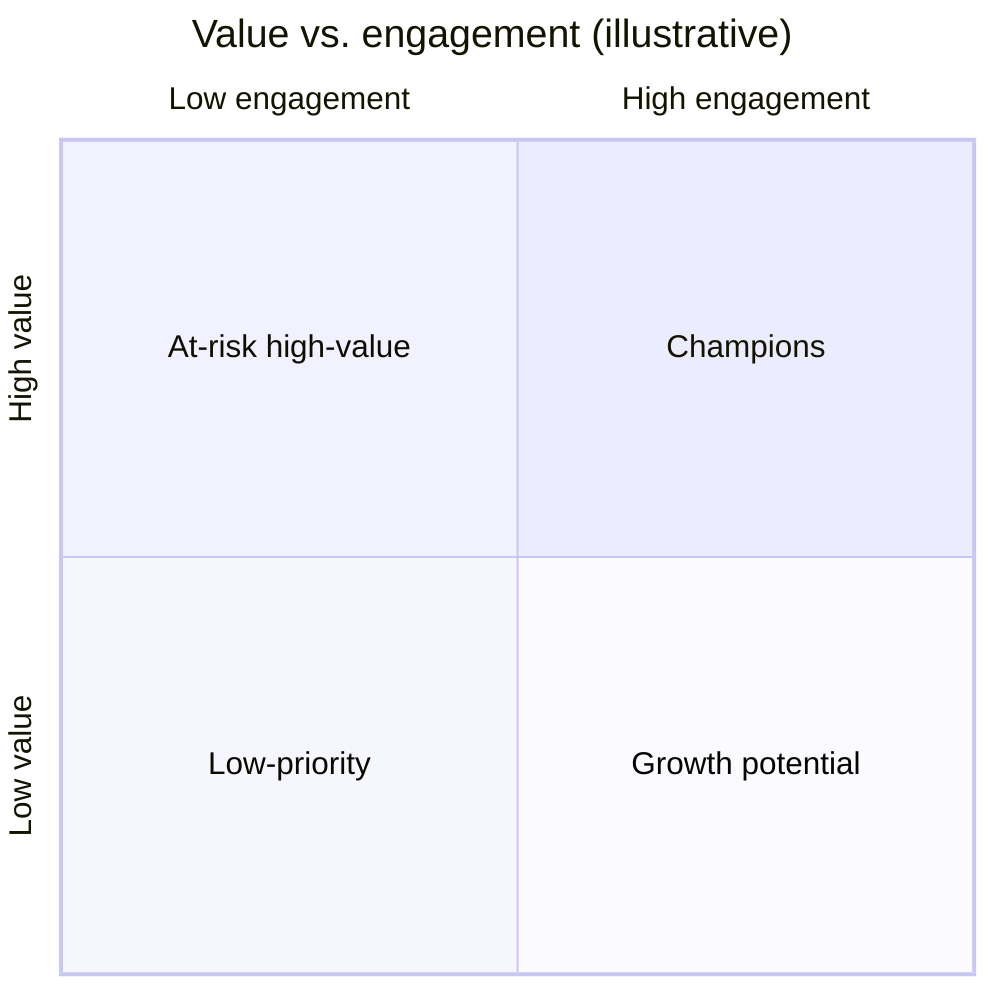
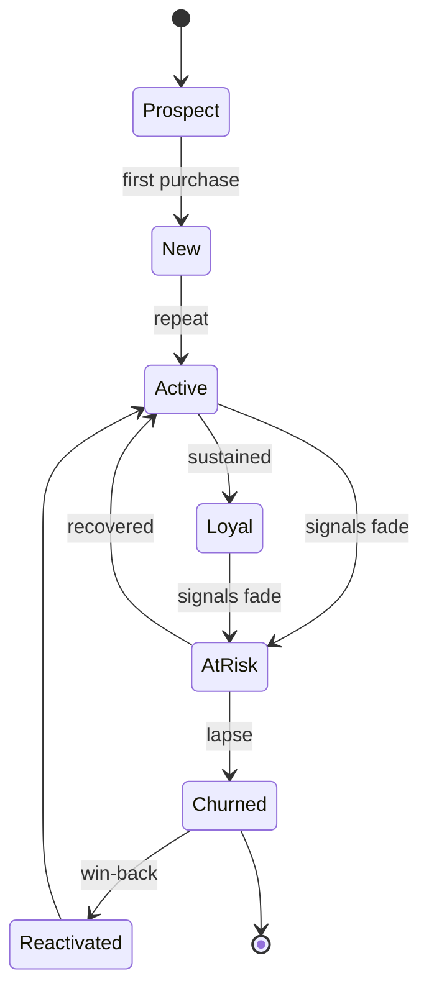

# Behaviour Models

**Pillar 3.** The quantitative understanding of customers: how they **purchase**,
how they **behave overall**, and where they are in their **journey**. These models
feed the [Insights Engine](insights-engine.md) and [Decision
Intelligence](decision-making.md).

## Purchase behaviour

How customers buy — the commercial core.

| Model / measure | Question it answers |
|---|---|
| **RFM** (Recency, Frequency, Monetary) | How recently, often, and valuably does this customer buy? |
| **Purchase propensity** | How likely is this customer to buy (soon / this product)? |
| **Basket / affinity** | What products are bought together or in sequence? |
| **Price sensitivity** | How does this customer respond to price and promotions? |
| **LTV / CLV** | What is this customer worth over their lifetime? |
| **Churn / lapse risk** | How likely is this customer to stop buying? |

## Overall behaviour

The relationship beyond the transaction — often the leading indicator of purchase
behaviour.

| Model / measure | Question it answers |
|---|---|
| **Engagement score** | How actively is the customer interacting (visits, usage, opens)? |
| **Feature / product usage** | What are they using, how deeply, and is it growing? |
| **Support & satisfaction** | How much friction are they hitting; how do they feel? |
| **Sentiment** | What is the tone of their feedback and interactions? |
| **Channel preference** | Where and how do they prefer to engage? |

## Behavioural segmentation

Rather than fixed demographic buckets, customers are grouped by *how they behave*,
and segments are re-learned as behaviour shifts.

Segments are **living**: a customer can move between them, and the emergence of a
new segment is itself an [insight](insights-engine.md).

## Journey & lifecycle

Where a customer is in their arc, and what typically comes next.

Transitions carry probabilities and drivers, so the agent knows not just *where* a
customer is but *where they're heading* and *why*.

## Modeling principles

1. **Explainable first.** Prefer models whose drivers can be surfaced; the
   [Insights Engine](insights-engine.md) needs the "why," not just the score.
2. **Features are shared.** Behavioural features computed here are reused across
   models and insights, defined once in the [integration layer](customer-integration.md).
3. **Honest uncertainty.** Every prediction carries a confidence/interval; the agent
   treats a shaky prediction differently from a firm one.
4. **Monitored for drift.** Behaviour changes; models are watched for decay and
   retrained, and drift is itself a signal.
5. **Start simple.** Well-understood methods (RFM, logistic/propensity models,
   clustering) before complex ones — complexity is added only where it pays.

## Open questions (for specs)

- Which models are v1 (likely RFM, churn/purchase propensity, behavioural
  clustering) vs. later.
- Build vs. buy for modeling infrastructure.
- Training/serving cadence (batch scores vs. on-demand).
- How model outputs are versioned so insights remain reproducible.
