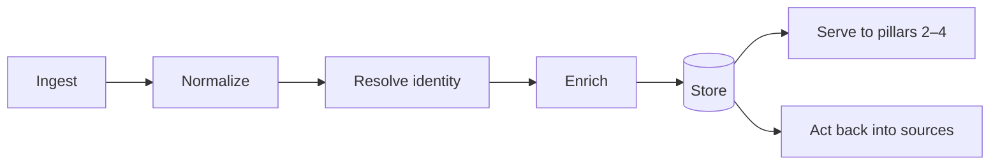
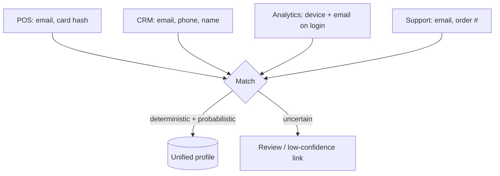
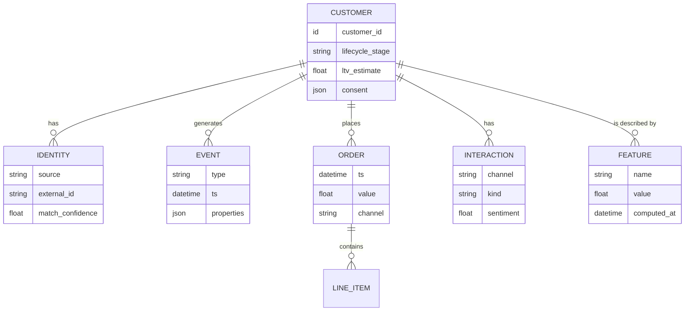

# Customer Integration Layer

**Pillar 1.** The foundation: turn fragmented, multi-source customer data into one
trustworthy, resolved, enriched view per customer — and provide the read/write
connection back to the business's systems.

> Nothing downstream is better than this layer. Insights and decisions inherit the
> quality, coverage, and trustworthiness of the integration beneath them.

## Responsibilities

1. **Ingest** — pull/receive data from the business's sources.
2. **Normalize** — map disparate schemas into a common model (customers, events,
   products, interactions).
3. **Resolve identity** — decide which records across sources are the same person.
4. **Enrich** — derive attributes and features (RFM, tenure, engagement scores).
5. **Store & serve** — maintain unified profiles + event history for the other
   pillars.
6. **Act** — provide the outbound connection so the agent can trigger actions
   (send a campaign, create a task, update a segment).

## Source taxonomy

| Category | Examples | Typical signal |
|---|---|---|
| **Commerce / transactions** | Shopify, POS, billing, subscriptions | What/when/how much bought |
| **CRM** | Salesforce, HubSpot | Accounts, contacts, pipeline, notes |
| **Product / behavioural** | Web & app analytics, event streams | Sessions, feature usage, clicks |
| **Support** | Zendesk, Intercom, tickets | Issues, resolution, satisfaction |
| **Marketing** | Email, ads, campaign platforms | Sends, opens, responses, spend |
| **Voice of customer** | Reviews, surveys, NPS | Sentiment, verbatim feedback |

!!! note "Build vs. sit-on-top"
    AutoAgentAI can either provide this layer itself or sit on an existing CDP /
    data warehouse and consume its unified profiles. The architecture supports both;
    which to lead with is a go-to-market and spec decision (see
    [roadmap](roadmap.md)).

## Identity resolution

The hardest and most valuable step: joining records that don't share a key.

- **Deterministic** matching on shared strong identifiers (email, phone, customer
  ID) first.
- **Probabilistic** matching on weaker combinations (name + address, device +
  behaviour) with a confidence score.
- **Confidence-aware**: low-confidence links are flagged rather than silently
  merged, because a bad merge corrupts every downstream insight.

## The unified profile (conceptual model)

This is a **conceptual** model, not a schema — it shows the entities the rest of
the system reasons about. Physical schema belongs in the [specs](specs/index.md).

## Privacy, consent, and trust

Customer data is sensitive and regulated. This layer is where those obligations are
enforced:

- **Consent-aware**: each profile records what the customer consented to; the agent
  may only use and act on data within that consent.
- **Data minimization**: collect and retain only what's needed for the decisions
  being made.
- **Regional rules**: support deletion/export requests and regional constraints
  (GDPR, CCPA, and similar).
- **Security**: encryption in transit and at rest; least-privilege access;
  auditable access logs.
- **Provenance**: every derived attribute records how and when it was computed, so
  downstream insights can be explained.

## Open questions (for specs)

- Real-time streaming vs. batch ingestion — and which sources need which.
- Where unified profiles are materialized (own store vs. warehouse vs. CDP).
- The exact match/merge policy and confidence thresholds.
- How outbound actions are authorized and rate-limited per source.
