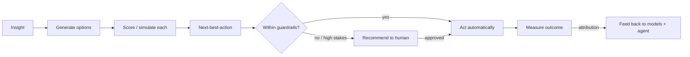
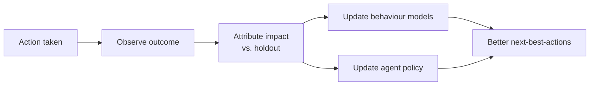

# Decision Intelligence

**Pillar 4.** The last mile: turn insights and model outputs into **decisions** —
specific recommendations and actions — and measure what they achieve.

> This pillar is why the product exists. An insight that never changes a decision
> delivered no value. Here, every insight becomes a *decision with an owner, an
> expected impact, and a way to tell whether it worked.*

## From insight to decision

## Next-best-action (NBA)

For a given customer or segment, the system determines the single most valuable
action to take *now*, given goals, constraints, and predicted response.

| Input | Role |
|---|---|
| **Insight / propensity** | What's true and likely about the customer |
| **Action catalog** | The menu of possible actions (offer, message, flag, nurture…) |
| **Expected response** | Modeled effect of each action on this customer |
| **Goals & constraints** | What the business is optimizing and its limits (budget, frequency caps) |
| **Guardrails** | What's allowed autonomously vs. needs approval |

The output is a ranked recommendation with the expected impact and the reasoning
behind it — never an unexplained directive.

## Action catalog (illustrative)

| Action | Typical trigger |
|---|---|
| **Targeted offer / promotion** | High purchase propensity, price sensitivity known |
| **Retention / save play** | Rising churn risk on a valuable account |
| **Onboarding nudge** | Customer stalled at a known drop-off step |
| **Cross-/up-sell** | Affinity or usage signals readiness |
| **Flag for human** | High-stakes or low-confidence situation |
| **Segment / audience update** | Behavioural segment membership changed |
| **Suppress / do nothing** | Contact fatigue or no positive expected value |

!!! note "Doing nothing is a decision"
    Suppressing an action (to avoid fatigue or negative value) is a first-class
    output, not the absence of one.

## Measuring outcomes (attribution)

A decision isn't finished when the action fires — it's finished when its effect is
measured and fed back.

- **Experimentation** where feasible: holdouts / A-B tests so impact is causal, not
  just correlational.
- **Attribution**: tie outcomes (purchase, retention, engagement lift) back to the
  action that drove them.
- **Learning loop**: results update the behaviour models and the agent's sense of
  what works — so recommendations improve over time.

## Human-in-the-loop and trust

Autonomy is **graduated** (see [guardrails](agent-loop.md#guardrails-and-autonomy-levels)):

- Low-stakes, high-confidence, reversible actions → the agent may act automatically.
- High-stakes, low-confidence, or costly actions → the agent *recommends*, a human
  approves.
- Every decision — auto or approved — is logged with its reasoning for audit and
  review.

This is how the product earns the right to act more autonomously over time: by
building a track record its operators can see and trust.

## Open questions (for specs)

- How goals/objectives are expressed and weighted (single metric vs. multi-objective).
- The experimentation framework (how holdouts are managed and measured).
- Default autonomy levels per action type and how they're configured.
- How conflicting recommendations across segments/goals are reconciled.
