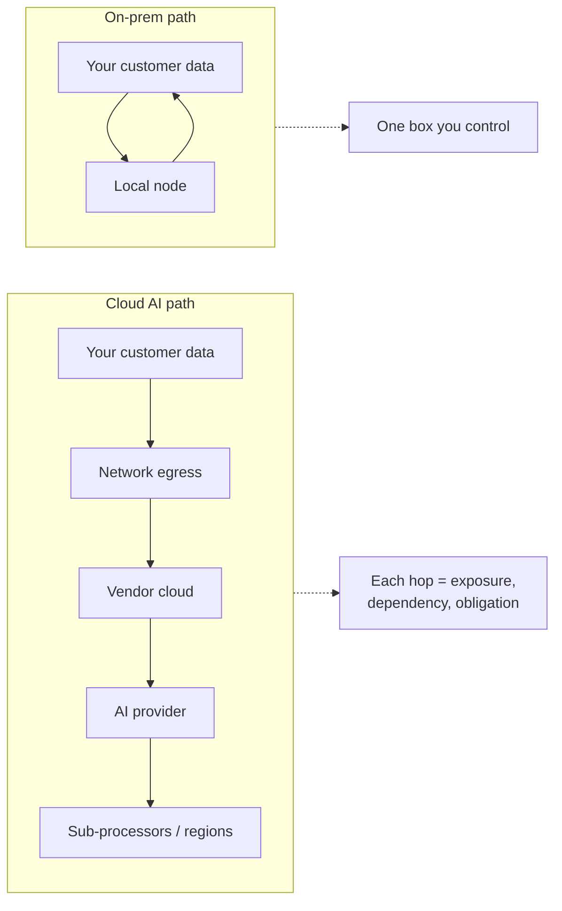
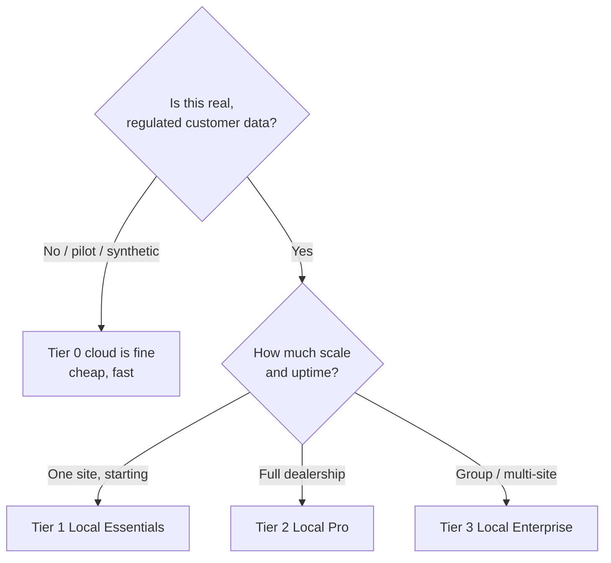

# Cloud vs On-Prem: The Risks

Tier 0 (cloud AI services + cloud storage) is cheap, fast, and genuinely works — and
for sensitive customer data it carries risks that on-prem simply removes. This page
lays the two side by side so the trade-off is made with eyes open, not by default.

!!! abstract "The one-sentence version"
    With cloud AI you are renting someone else's computer to hold and read your most
    valuable, most regulated data; with on-prem you own the box, the model, and the
    risk surface — and the data never leaves.

## Where the risk actually lives

Every arrow leaving your building is a place where data can be exposed, retained,
subpoenaed, repriced, or quietly used for something you didn't intend.

## The risks of cloud AI for this data

| Risk | What it means for a dealership |
|---|---|
| **Data leaves your control** | Customer PII, finances, and behaviour sit on infrastructure you don't own and can't fully inspect. |
| **Secondary use / training** | Depending on terms, prompts and data may be logged, retained, or used to improve vendor models. Terms can change. |
| **Vendor lock-in & pricing power** | Your workflows depend on an API someone else prices, throttles, deprecates, or changes. |
| **Availability dependence** | An outage or a suspended account at the provider takes your showroom tools down with it. |
| **Breach surface** | A breach anywhere in the vendor → AI-provider → sub-processor chain can expose your customers, and it's your name on the apology. |
| **Compliance drag** | Processor agreements, transfer mechanisms, audits, and disclosures — ongoing paperwork and liability for every vendor in the chain. |
| **Cross-border exposure** | Data may be processed in regions whose laws (and access powers) differ from yours. |
| **Loss of provenance** | Harder to prove *why* an automated decision was made when the reasoning happened in a black-box API. |
| **Confidential leakage** | Your competitive edge — how you sell, what works — flows through a third party. |

## The risks on-prem removes (and the ones it adds)

**Removed or sharply reduced:** data leaving the premises, secondary use by a
vendor, cross-border transfer, dependence on a provider's pricing/uptime/terms, and
most of the processor-chain compliance drag.

**Added (and manageable):**

| On-prem cost | Mitigation |
|---|---|
| Upfront hardware (capex) | Scoped by tier; amortizes against avoided per-call cloud fees and risk |
| You run the box | Managed appliance model, updates, and support; thin kiosks/iPads keep it simple |
| You own uptime | UPS, and HA/redundancy at Tier 3 |
| Model updates are yours to apply | Open models are swappable; updates are a controlled, local step |

On-prem trades a *recurring, external, hard-to-bound* risk (someone else holds your
data) for a *one-time, internal, boundable* cost (you run a server). For data this
sensitive, that trade usually favors on-prem.

## When cloud (Tier 0) is still the right call

Tier 0 is not wrong — it's wrong *for sensitive data*. It's a good fit when:

- You're running a **pilot** or demo to prove value before buying hardware.
- The workload uses **non-sensitive or synthetic** data.
- You explicitly accept the posture for a bounded, short-lived purpose.

The product is designed so you can **start on Tier 0 and migrate the identical
workflows on-prem** once value is proven — no rebuild. See
[On-Prem AI & Hardware](on-prem-ai-hardware.md).

## The decision, framed

!!! warning "The asymmetry that matters"
    A cloud cost saving is visible and small each month. A privacy failure with
    customer PII is invisible until it isn't, and then it is large, public, and
    permanent. The risks are not symmetric — which is why, for this data, the
    default recommendation is on-prem. See
    [Privacy, PII & Future-Proofing](privacy-pii-future-proofing.md).
