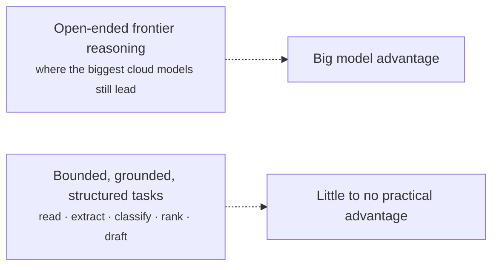

# Local Models Are Enough

**Thesis:** for the specific jobs AutoAgentAI needs an AI model to do, today's
open-source **local** models do the work as well as the big cloud models — well
enough that giving up the cloud costs you nothing that matters, and buys you
everything on the [privacy](privacy-pii-future-proofing.md) and
[risk](cloud-vs-onprem-risks.md) pages.

!!! abstract "Why this is true now and wasn't before"
    The gap between frontier cloud models and the best open models has narrowed to
    the point where, on *bounded, well-scoped tasks*, they are interchangeable. Our
    tasks are exactly that kind — bounded and well-scoped — not open-ended frontier
    reasoning. You don't need the world's biggest model to read a sales note.

## What the model actually has to do here

The agent doesn't need a model that can do everything. It needs a model that can do
*these* things, reliably, on dealership data:

| Job | What it looks like | Difficulty for a local model |
|---|---|---|
| **Read & understand** notes, messages, reviews | "Customer worried about resale value, has two kids" | Easy — well within local models |
| **Extract structure** from free text | Pull intent, budget signals, objections into fields | Easy / moderate |
| **Classify & tag** | Intent, sentiment, lifecycle stage, segment | Easy |
| **Summarize** | Condense a visit or a history into a brief | Easy |
| **Rank & choose** | Next-best-action from a known menu | Moderate — and aided by the models in [Behaviour Models](../behaviour-models.md) |
| **Draft language** | A friendly follow-up, a kiosk prompt | Easy |
| **Reason over retrieved facts** | Answer grounded in the local knowledge base | Moderate — handled well with retrieval |

None of these is a frontier task. They are the bread-and-butter capabilities that
even modest open models now handle, especially when **grounded in retrieval** (the
model reasons over *your* facts rather than from memory) and **constrained to
structured outputs** (it fills fields, not freeform essays).

## Why scoped tasks favor local models

Three design choices shrink the model's burden until a local one is plenty:

1. **Retrieval-grounded.** The knowledge lives in the local
   [knowledge base](../customer-integration.md); the model reads from it instead of
   recalling. This leans on comprehension, which local models are good at — not on a
   giant parametric memory.
2. **Structured outputs.** The agent asks the model to populate fields and pick from
   menus, not to free-associate. Constrained tasks are where small models are most
   reliable.
3. **The agent does the planning.** Multi-step logic lives in the
   [agent loop](../agent-loop.md) and the deterministic tools — not in one giant
   model call. Each model call is small and well-defined.

## Honest limits and how we handle them

Being truthful about where local models are weaker, and the mitigations:

| Limitation | Mitigation |
|---|---|
| Hardest open-ended reasoning lags frontier models | We don't route such tasks to the model; the agent decomposes them |
| Smaller models hallucinate more when ungrounded | Retrieval-grounding + "answer only from provided facts" + provenance checks |
| Throughput is bounded by your GPU | Tier sizing ([hardware](on-prem-ai-hardware.md)); batch non-interactive work |
| Occasional task needs more horsepower | Optional: a larger local model at Tier 2/3, or an explicit, consented, non-PII cloud call for that one task |

## The economics flip, too

Cloud models charge per call, forever, and the bill grows with success. A local
model is a **fixed cost** you've already paid: once the hardware is in, inference is
effectively free and unlimited, which changes how the agent can behave — it can
afford to be *continuously* curious (the whole point of an
[autonomous agent](../agent-loop.md)) without a meter running on every thought.

| | Cloud models | Local models |
|---|---|---|
| Cost shape | Per-call, recurring, scales with use | Fixed capex, then ~free inference |
| "Always-on curiosity" | Expensive — every loop costs money | Cheap — run the loop as often as you like |
| Data exposure | Leaves premises | Stays on premises |
| Dependency | Vendor terms/pricing/uptime | Yours |

## The conclusion

> For AutoAgentAI's actual workload — reading, extracting, classifying, summarizing,
> ranking, and drafting over a dealership's own grounded data — **a local
> open-source model does the job as well as a cloud model**, at a fixed cost, with
> the data never leaving the building. The cloud's remaining edge is in open-ended
> frontier reasoning the agent is designed not to depend on.

That is what makes the [on-prem tiers](on-prem-ai-hardware.md) not a compromise but
the *better* engineering choice for this problem.

!!! note "Claims here are directional"
    Specific model choices and measured quality bars are a Phase-1
    [specification](../specs/index.md) task — including the evaluation suite that
    proves, on real dealership tasks, that the chosen local model clears the bar.
