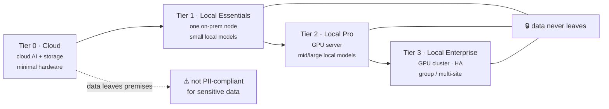
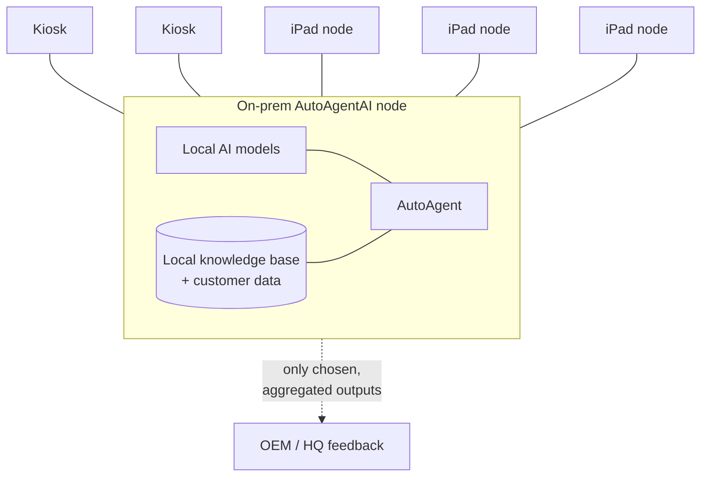

# On-Prem, Local AI & Hardware

AutoAgentAI is built so it can run **entirely on the dealership's own premises**,
on local hardware, with **local AI models**, so that **customer data never leaves
the building**. This is not a bolt-on — it is a first-class deployment mode, and
for most dealerships it is the *recommended* one, because the data involved is
exactly the kind that privacy law treats as sensitive (see
[Privacy, PII & Future-Proofing](privacy-pii-future-proofing.md)).

!!! abstract "The core promise"
    Everything the agent needs — the models that read and reason, the knowledge
    base, the customer data, the decision-making — can live on a machine in the
    back office. The only things that cross the network are the things you
    explicitly choose to send out (e.g. a manufacturer feedback summary), and even
    those are on your terms.

## Why on-prem is now realistic

Two things changed:

1. **Open-source local models got good enough.** The open models you can run on a
   single workstation today do the specific jobs this product needs — reading
   notes, classifying intent, summarizing, extracting structure, ranking options,
   drafting language — at a quality that was cloud-only a short time ago. See
   [Local Models Are Enough](local-models-are-enough.md).
2. **Agentic AI matured.** The orchestration, tool-use, and memory patterns that
   make an autonomous agent work no longer require a frontier cloud model for every
   step. The heavy reasoning can be reserved, batched, or done locally.

Together, these make a fully local, private, autonomous customer-intelligence agent
*buildable on dealership hardware* — which a few years ago it was not.

## The four deployment options

AutoAgentAI ships as **four tiers**, from cheapest-but-not-private to fully
sovereign. A dealer picks based on how sensitive their data is, what they can spend,
and how much they want to keep in-house.

| | **Tier 0 — Cloud** | **Tier 1 — Local Essentials** | **Tier 2 — Local Pro** | **Tier 3 — Local Enterprise** |
|---|---|---|---|---|
| **AI** | Cloud AI services | Small/mid local models | Mid/large local models | Largest local models, redundant |
| **Storage** | Cloud | On-prem | On-prem | On-prem, replicated |
| **Hardware** | None / minimal | One mini-server or workstation | GPU server/workstation | GPU cluster, HA, UPS |
| **Data location** | Third-party cloud | **On premises** | **On premises** | **On premises (sovereign)** |
| **PII-law posture** | ⚠ Not compliant for sensitive data | Compliant | Compliant | Compliant + auditable at scale |
| **Cost** | Lowest upfront | Low | Moderate (capex) | Highest (capex) |
| **Best for** | Pilots, low-sensitivity, proof-of-value | Single rooftop, getting started privately | A full dealership operation | Dealer groups, flagship, multi-site |
| **Scale** | Elastic | 1 site, light load | 1 site, full load, many nodes | Many sites, high concurrency |

### Tier 0 — Cloud (cheap, fast, **not** PII-compliant)

Uses cloud AI services and cloud storage. **No or minimal on-site hardware.** It is
the cheapest and quickest way to stand the system up and prove it works — and it
**can genuinely work**. The catch is unavoidable: customer data leaves the premises
and passes through third-party cloud and AI providers, so it is **not suitable for
PII-regulated customer data**. Use it for pilots, demos, non-sensitive workloads, or
proving value before investing in hardware — with eyes open about the trade-off
(see [Cloud vs On-Prem: The Risks](cloud-vs-onprem-risks.md)).

### Tier 1 — Local Essentials (entry on-prem, private)

A single on-prem node — a capable mini-server or workstation — runs small-to-mid
**local** models and holds the data locally. **Data never leaves the building.**
Modest cost, modest footprint; ideal for a single rooftop that wants privacy from
day one and a real but contained workload.

### Tier 2 — Local Pro (dealership-grade, private)

A proper on-prem **GPU server/workstation** runs mid-to-large local models with a
local knowledge base and vector store, driving a full fleet of kiosks and iPads
across the dealership. Handles the real concurrent load of a busy showroom. This is
the sweet spot for most single dealerships that take their data seriously.

### Tier 3 — Local Enterprise (group / flagship, sovereign)

A **GPU cluster** with high availability, redundancy, and the largest local models,
serving a dealer group or multiple sites. Data sovereignty across the whole group,
auditable at scale, with edge-sync between locations. For organizations where the
data is strategic and downtime is unacceptable.

!!! note "Same product, different engine"
    All four tiers run the *same* AutoAgentAI — same pillars, same interfaces, same
    agent. What changes is **where the compute and data live** and **how much** of
    it you can run at once. A dealer can start at Tier 0 to prove value, then move
    the exact same workflows on-prem at Tier 1–3 when ready.

## Interfaces: kiosks and iPads

The system meets people where they are, with two complementary interfaces:

- **McDonald's-style self-serve kiosks.** Large, friendly, touch-first terminals —
  the same pattern customers already trust from quick-service restaurants. Low
  intimidation, self-paced, and they capture rich interaction data as a natural
  by-product of being genuinely useful to the customer.
- **iPads.** The mobile, handheld form of the same system. Crucially, **iPads are
  generally the *nodes* that connect to the whole system** — a salesperson or
  greeter carries one, and through it the whole local AutoAgentAI (models, data,
  agent) is at hand anywhere on the lot or in the showroom.

The iPads and kiosks are **thin** — the intelligence and the data stay on the
on-prem node. A lost or stolen iPad carries no customer database; it is a window
into the local system, not a copy of it.

## What a local deployment contains

| Component | Role | Lives where |
|---|---|---|
| **Local AI models** | Reading, reasoning, extraction, drafting, ranking | On-prem node (GPU) |
| **Knowledge base / vector store** | The dealership's customers, vehicles, history | On-prem storage |
| **Unified customer profiles** | The resolved view per customer | On-prem storage |
| **AutoAgent runtime** | Orchestration, memory, guardrails | On-prem node |
| **Kiosk + iPad apps** | Thin interfaces / nodes | Devices on the LAN |
| **Outbound (optional, chosen)** | Aggregated OEM feedback, group sync | Egress on your terms |

## Hardware guidance (illustrative)

Exact specifications are a Phase-1 [spec](../specs/index.md) decision and depend on
chosen models and load. As rough orientation only:

- **Tier 1:** a single modern workstation with one capable GPU and ample RAM/SSD —
  enough for small/mid local models and a single site's light, interactive load.
- **Tier 2:** a dedicated GPU server (one or more workstation/data-center GPUs),
  fast NVMe storage, and a UPS — enough for larger models and a showroom's full
  concurrent kiosk + iPad load.
- **Tier 3:** multiple GPU servers in a rack with redundancy, high-availability, and
  replicated storage — for dealer-group scale and uptime guarantees.

!!! warning "Numbers here are orientation, not a quote"
    Treat all hardware and cost statements as directional. Final sizing comes with
    the [specifications](../specs/index.md) once models and expected load are fixed.

---

**Next:** [Privacy, PII & Future-Proofing](privacy-pii-future-proofing.md) ·
[Cloud vs On-Prem: The Risks](cloud-vs-onprem-risks.md) ·
[Local Models Are Enough](local-models-are-enough.md)
