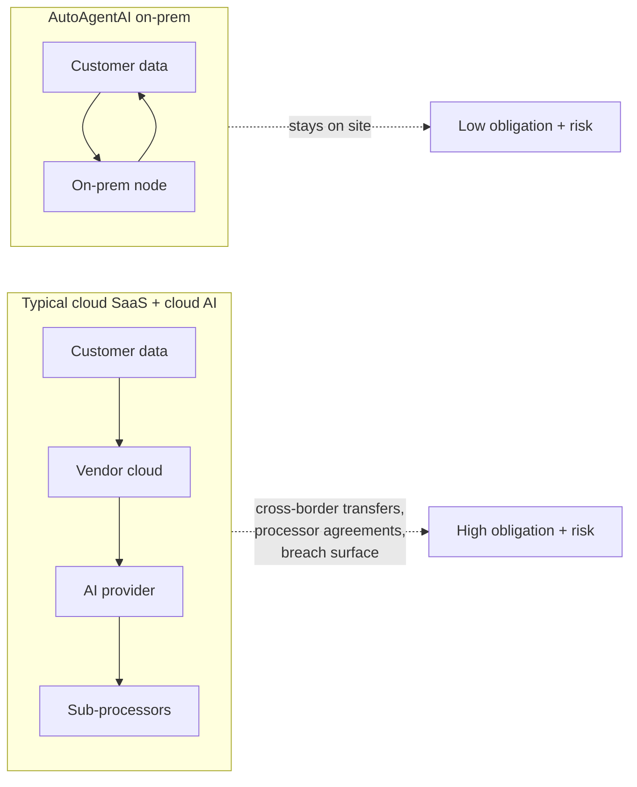

# Privacy, PII & Future-Proofing

AutoAgentAI works with the most sensitive data a dealership holds: who its customers
are, what they own, what they can afford, what they want, and how they behave. That
is **personally identifiable information (PII)**, and in many cases special-category
or financial data on top. The product's privacy stance is therefore not a feature —
it is a precondition.

!!! info "Not legal advice"
    This page explains the design posture and the principles it is built around. It
    is not legal advice. Each dealer's obligations depend on their jurisdiction and
    should be confirmed with counsel. The point of the on-prem design is to make
    compliance *easier to achieve and prove*, whatever the specific rules.

## The regulatory landscape (why this matters)

Customer data is governed by a growing, tightening web of privacy law. A
non-exhaustive map of what dealerships touch:

| Regime / area | Who/what it covers | Core demands (simplified) |
|---|---|---|
| **GDPR** (EU/EEA) | Any EU resident's personal data | Lawful basis, consent, minimization, access/erasure rights, breach reporting, limits on transfers |
| **CCPA / CPRA** (California) | California consumers | Disclosure, opt-out of sale/sharing, deletion rights, sensitive-PI limits |
| **PIPEDA** (Canada) / provincial laws | Canadian individuals | Consent, purpose limitation, access, safeguards |
| **State privacy laws (US)** | A growing list of states | Access, deletion, opt-out, data-minimization echoes of CPRA |
| **Financial data rules** | Credit apps, financing | Heightened safeguards, Gramm-Leach-Bliley-style handling in the US |
| **Biometric / image laws** | Camera/vision data (e.g. BIPA) | Often require explicit consent and strict handling |

The direction of travel is one-way: **more** rights for individuals, **more**
restrictions on moving and selling data, **more** scrutiny of AI and automated
decisions. A system designed around last year's rules ages badly.

## The design posture: data that doesn't leave can't leak

The single most powerful privacy move is **not moving the data**. AutoAgentAI's
on-prem tiers (see [On-Prem AI & Hardware](on-prem-ai-hardware.md)) keep customer
data and the AI that reads it **inside the dealership**. This collapses whole
categories of risk and obligation:

- **No third-party processors to paper over.** No chain of cloud vendors and
  AI-provider sub-processors each needing contracts, assurances, and audits.
- **No cross-border transfer problem.** Data that never leaves the premises never
  crosses a border.
- **A tiny breach surface.** You cannot leak from a cloud you are not using.
- **Honest answers to customers.** "Your information stays here, on our systems, and
  is used to serve you" is both a compliance posture and a trust-builder.

## Principles built in

The product is designed around the principles the laws keep repeating, so that
compliance is the default rather than a scramble:

1. **Data minimization.** Collect and retain only what a decision needs.
2. **Purpose limitation & consent.** Each customer record carries what they
   consented to; the agent only uses and acts within that consent.
3. **Individual rights are operational.** Access, correction, and **erasure**
   requests are first-class actions the system can execute, with proof.
4. **Provenance & auditability.** Every insight and action traces to its data and
   reasoning — so you can show *why* a decision was made, which regulators
   increasingly require for automated decisions.
5. **Security by default.** Encryption, least-privilege access, and access logging —
   far simpler to guarantee on a box you control than across a vendor chain.
6. **Human accountability.** High-stakes or automated decisions stay explainable and
   reversible, with a human in the loop where it matters.

## Future-proofing

"Future-proof" here means specific, testable things:

- **Sovereignty by default.** Because data stays on-prem, most *new* transfer,
  localization, and sale-of-data rules land as no-ops — you already aren't doing the
  risky thing.
- **Model independence.** Local, open models mean you are not hostage to a cloud
  provider changing terms, prices, retention policies, or training practices. If a
  better open model appears, you swap it in; your data and workflows don't move.
- **Auditable AI.** As rules on automated decision-making tighten, the provenance
  trail is already there to demonstrate fairness, basis, and human oversight.
- **Portability.** The same AutoAgentAI runs across all four tiers, so a dealer can
  tighten posture (Tier 0 → Tier 3) as obligations grow, without re-platforming.
- **Consent that travels forward.** Consent and preferences are modeled explicitly,
  so new consent requirements extend the model rather than breaking it.

!!! tip "The strategic read"
    Privacy law is a moving target that only moves in one direction. The cheapest
    way to keep up with a tightening rule-set is to **not depend on the behaviours
    those rules restrict** — moving, selling, and exposing customer data. On-prem,
    local-model AutoAgentAI is, in effect, a bet that sovereignty is the durable
    position. See [Cloud vs On-Prem: The Risks](cloud-vs-onprem-risks.md) for the
    other side of that bet.
