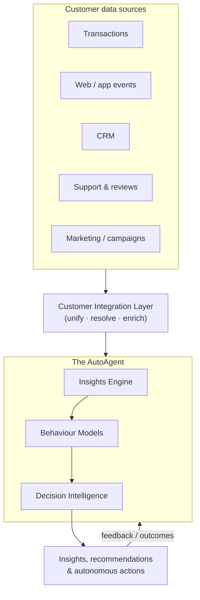

# AutoAgentAI

**AutoAgent and Customer-Integrated Custom Insights into Purchase and Overall Behaviour and Decision Making.**

!!! abstract "One-line definition"
    AutoAgentAI is an **autonomous AI agent** that unifies a business's customer
    data and continuously produces **custom insights** into how customers
    **buy**, **behave**, and **decide** — then surfaces or acts on those insights
    to improve decisions.

!!! tip "Focus: automotive, on-prem, private"
    The beachhead is the **car industry** — dealerships and, through them, OEMs —
    where the buyer's pre-purchase decision behaviour is the most valuable,
    least-captured data there is. AutoAgentAI is built to run **on-prem on local AI
    models**, so sensitive customer data **never leaves the building**. See
    [Deployment & Privacy](deployment/on-prem-ai-hardware.md) and the
    [Perspectives](perspectives/the-most-valuable-data-in-autos.md) articles.

---

## Why this exists

Businesses sit on fragmented customer data — transactions, web and app events,
CRM records, support tickets, reviews, campaign responses. The signal about
*why* customers buy, how they behave, and how they decide is spread across those
silos and mostly goes unread. Static dashboards answer yesterday's questions and
wait for a human to ask the next one.

AutoAgentAI replaces "dashboard you have to drive" with "**agent that drives
itself**": it integrates the data, keeps looking, generates insights tailored to
each business and customer, and turns them into recommended or automated actions.

## The product in one picture

## What makes it distinct

| Term in the name | What it means for the product |
|---|---|
| **AutoAgent** | Autonomous, goal-driven, continuous — not a static report. It decides what to look at next. |
| **Customer-Integrated** | Unifies every customer touchpoint into one resolved view per customer. |
| **Custom Insights** | Tailored to the specific business and customer — not generic benchmark metrics. |
| **Purchase behaviour** | What, when, how much, how often, and why customers buy (or don't). |
| **Overall behaviour** | Engagement, usage, support, sentiment — the whole relationship, not just the till. |
| **Decision Making** | Insights are framed as decisions: next-best-action, who to target, what to change. |

## Pick your lens

The same story, told for whoever's reading — start with whichever fits you:

- 📄 **[Executive Summary](audiences/executive-summary.md)** — the whole thing on one page ([PDF](assets/AutoAgentAI-Executive-Summary.pdf)).
- 💼 **[Investor Pitch](audiences/investor-pitch.md)** — the opportunity, moat, model, and the ask.
- 🛠️ **[Technical Overview](audiences/technical-overview.md)** — architecture, on-prem stack, local models, security.
- 🚗 **[For Sales Managers](audiences/for-sales-managers.md)** — plain talk: what it does for your store.

## How to read these docs

1. **[Vision](vision.md)** and **[Problem & Motivation](problem-motivation.md)** — the *why*.
2. **[Concepts & Glossary](concepts-glossary.md)** — the shared vocabulary.
3. **[Architecture](architecture.md)** — the *how*, pillar by pillar:
   [Customer Integration](customer-integration.md) ·
   [Insights Engine](insights-engine.md) ·
   [Behaviour Models](behaviour-models.md) ·
   [Decision Making](decision-making.md) ·
   [The AutoAgent Loop](agent-loop.md).
4. **[Use Cases](use-cases.md)** — made concrete.
5. **[Deployment & Privacy](deployment/on-prem-ai-hardware.md)** — on-prem/local AI, the four tiers, [privacy & PII](deployment/privacy-pii-future-proofing.md), and [cloud vs on-prem risks](deployment/cloud-vs-onprem-risks.md).
6. **[Perspectives](perspectives/the-most-valuable-data-in-autos.md)** — the automotive thesis: the industry's most valuable data, the salesperson's changing role, and [closing the loop to the OEM](perspectives/automotive-data-closing-the-loop.md).
7. **[Roadmap](roadmap.md)** and **[Specifications](specs/index.md)** — the path to building.

!!! note "Status"
    This is a **concept-and-documentation** repository. It organizes the thinking
    and hosts it, so that formal specs and implementation can follow. Everything
    here is a working draft meant to be challenged and refined.
