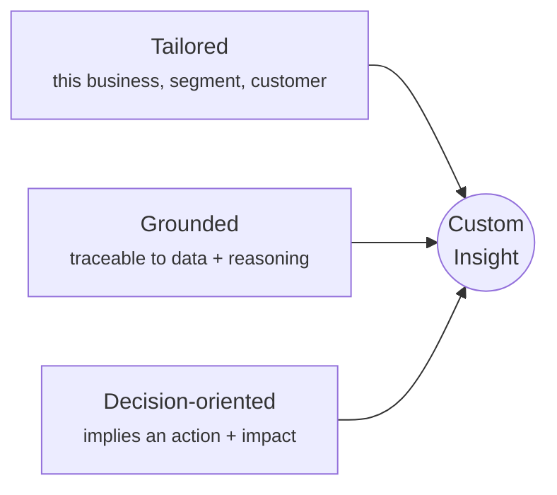
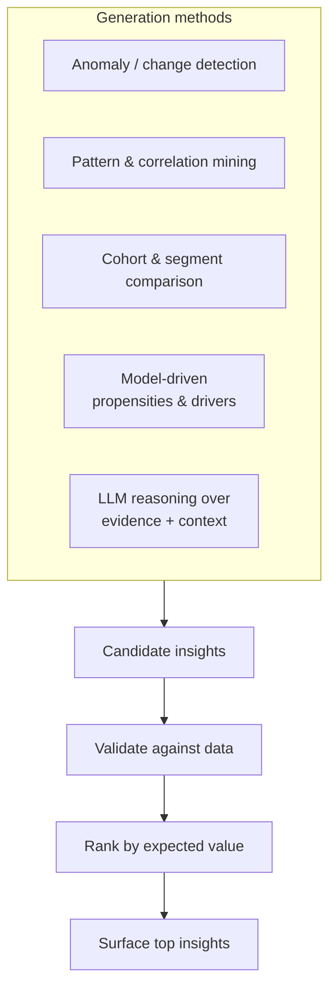

# Insights Engine

**Pillar 2.** Turns unified data and model outputs into **custom insights** —
findings that are tailored, grounded, and decision-oriented.

> An insight here is not a metric and not a chart. It is a *claim about the
> business's customers, backed by evidence, that implies an action.*

## What makes an insight "custom"

A finding earns the name only when all three hold. "Average order value is $48" is
a metric. "Customers who buy accessories within 14 days of their first order have
2.3× the 12-month LTV, and 60% of first-time buyers never see an accessory offer"
is an insight — tailored, grounded, and pointing at an action.

## Anatomy of an insight

| Field | Meaning |
|---|---|
| **Statement** | The claim, in plain language. |
| **Evidence** | The data, segment, and model output behind it. |
| **Confidence** | How strongly the data supports it. |
| **Scope** | Which customers/segment it applies to and how many. |
| **Expected impact** | What acting on it is worth (e.g. estimated revenue/retention). |
| **Suggested decision** | The action it implies — handed to [Decision Intelligence](decision-making.md). |
| **Provenance** | The trace from raw data → reasoning → this statement. |

## How insights are generated

The engine combines complementary methods rather than relying on one:

- **Anomaly / change detection** — what moved, where, and for whom.
- **Pattern & correlation mining** — recurring associations in behaviour.
- **Cohort & segment comparison** — who differs from whom and why it matters.
- **Model-driven** — propensities and their drivers from the [behaviour
  models](behaviour-models.md).
- **LLM reasoning** — synthesizes evidence and business context into a plain-language,
  decision-framed statement; also proposes *what to investigate next* for the agent.

!!! warning "Guard against spurious findings"
    More methods means more candidate claims, and more chances for false positives.
    Every candidate is **validated against the data** (effect size, significance,
    holdout checks) before it is surfaced, and confidence is reported honestly.

## Ranking: value over volume

The engine's job is not to produce many insights but the *right* ones. Candidates
are ranked by **expected value of acting**, roughly:

> **priority ≈ (impact if true) × (confidence) × (actionability) ÷ (effort/cost)**

Low-confidence, low-impact, or un-actionable findings are suppressed. The agent can
tune this ranking toward current goals (e.g. prioritize retention this quarter).

## Types of insight (illustrative)

| Type | Example |
|---|---|
| **Opportunity** | "Segment X is under-offered product Y they're likely to want." |
| **Risk** | "These accounts show the early churn signature seen in past lapsers." |
| **Driver** | "Support response time is the strongest predictor of repeat purchase." |
| **Segment shift** | "A fast-growing new behavioural segment has emerged this month." |
| **Anomaly** | "Conversion for channel Z dropped 18% for mobile users only." |
| **Lifecycle** | "Customers stall at onboarding step 3; those who pass it retain 2×." |

## Interfaces

- **Pull**: an operator asks a question in plain language; the engine answers with a
  grounded insight.
- **Push**: the agent runs the engine continuously and surfaces high-value insights
  without being asked.

Both paths produce the same structured insight object, so everything is explainable
and feeds [Decision Intelligence](decision-making.md) identically.

## Open questions (for specs)

- The exact validation/statistical bar before surfacing.
- How business context and goals are encoded for the LLM reasoning step.
- De-duplication and "insight fatigue" controls (not re-surfacing known findings).
- How confidence is calibrated and communicated.
