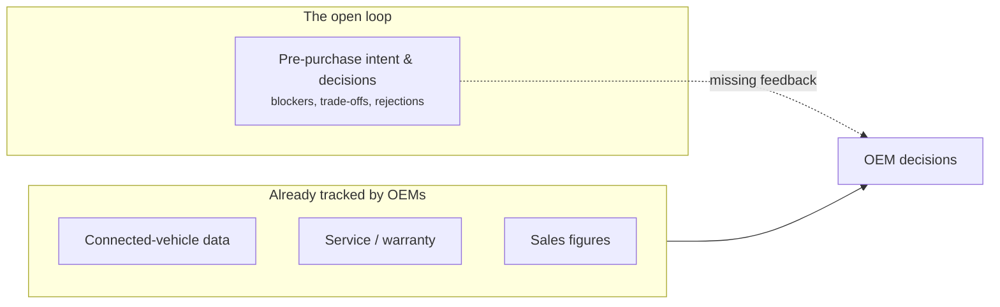
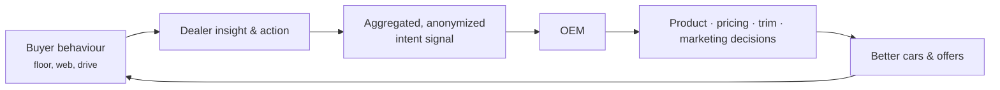
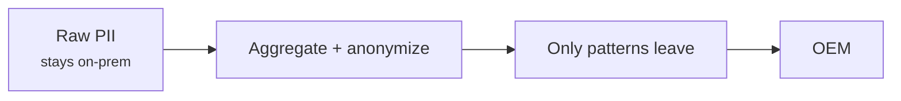

# Valuable Auto Data & Closing the Loop to the OEM

Automotive is already a data-rich industry. Manufacturers track vehicles, patterns,
and behaviour at enormous scale — through connected vehicles, telematics, service
records, and more. But there's a gap in that data that has stayed open: **the
showroom-floor, pre-purchase, decision-making behaviour of the actual human buyer.**
AutoAgentAI captures that missing piece and **closes the loop — feeding real buyer
intent all the way back to the OEM, where it can change decisions.**

!!! abstract "The gap in one line"
    OEMs know everything about the *car* and a lot about the *driver after they buy*.
    They know almost nothing, in real time, about *why a person did or didn't buy on
    the floor.* That's the loop we close.

## The automotive data landscape

Auto data comes in several layers. Most are already well-captured; one is not.

| Data layer | Example | Captured today? |
|---|---|---|
| **Connected-vehicle (CV) / telematics** | Driving patterns, usage, location, vehicle health | ✅ Heavily, by OEMs |
| **Service & warranty** | Repairs, recalls, maintenance behaviour | ✅ Well captured |
| **Computer-vision / in-store sensing** | Lot traffic, dwell, footfall | ⚠ Partly, crudely |
| **Transaction / finance** | What sold, at what price, financed how | ✅ Captured |
| **Pre-purchase intent & decision behaviour** | *Why* a buyer leaned in, hesitated, chose, or walked | ❌ **Barely captured at all** |

The last row is the richest in *why*, the most valuable
([How Valuable This Data Is](how-valuable-this-data-is.md)), and the least captured —
because capturing it was impossible for the people on the floor
([Why Salespeople Can't Capture This Data](why-salespeople-cant-capture-this.md)).

## "They already track behaviour" — but the loop is open

OEMs are superb at tracking the vehicle and the post-purchase driver via **connected
vehicles**. What they *don't* have is a live read on the human decision that happens
before the sale:

So the OEM optimizes the product and the post-sale experience with great data, and
optimizes *what buyers actually want and reject* with almost none — relying on lagging
sales numbers, dealer anecdote, and surveys. The loop from **buyer decision → OEM
decision** is broken.

## Closing the loop

AutoAgentAI captures the missing layer at the point of decision (kiosks, iPads, every
channel), turns it into insight, and — with consent and in **aggregated,
privacy-respecting** form — feeds it up the chain:

Now the OEM learns things it currently can only guess:

- **Which trims and options buyers actually weigh** — and which they reject, and why.
- **Real, live price and running-cost sensitivity** — before it shows up in sales.
- **The true blockers** that lose sales ("worried about resale," "fuel cost") at
  scale, in near real time.
- **What assurance closes the deal** — feeding back into messaging and product.

This complements the OEM's existing connected-vehicle and service data: they had the
*car* and the *owner*; now they also have the *buyer's mind at the moment of
decision.* That's the full picture.

## Privacy makes the loop legitimate

Feeding data up the chain is exactly where privacy usually breaks — which is why the
on-prem design matters here most. Raw PII **stays at the dealership**; only
**aggregated, anonymized, consented** signal flows up. The OEM gets the *patterns*,
not the people. See [Privacy, PII & Future-Proofing](../deployment/privacy-pii-future-proofing.md).

## Why this is a step-change, not an increment

OEMs already spend fortunes trying to infer buyer intent indirectly — clinics, focus
groups, surveys, inferring it backwards from sales. AutoAgentAI gives them the real
thing, measured at the moment of decision, continuously, from the actual buying
population. That the loop was **impossible to close before** — and now isn't — is the
subject of the next article:
[The Closed Loop](the-closed-loop.md).

!!! note "Illustrative"
    Specific signals and flows are illustrative of the mechanism. What is aggregated,
    how, and under what consent is a privacy-and-spec design task, not a promise of a
    particular data-sharing arrangement.
