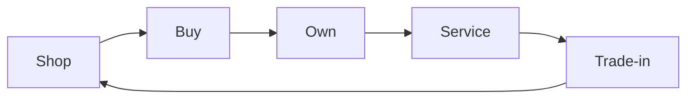
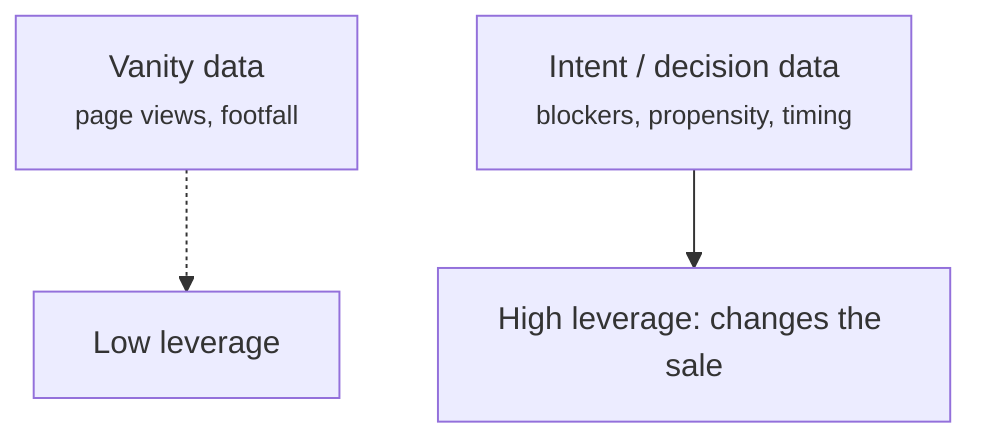
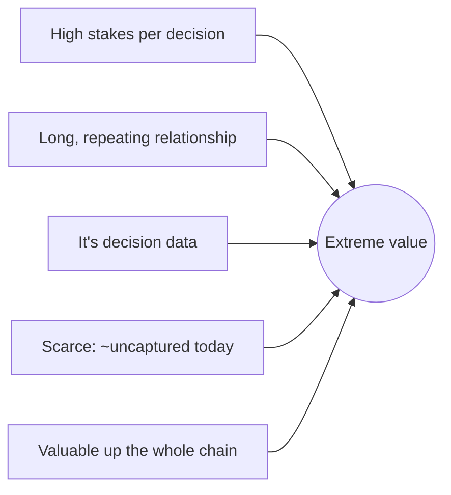

# How Valuable This Data Is

Customer intent-and-behaviour data in automotive isn't "nice to have." It is, pound
for pound, some of the most valuable commercial data that exists — because of what a
single correct read is worth, how long the relationship lasts, and how far up the
chain the signal matters. This article makes the value explicit.

!!! abstract "Why it's worth so much"
    High transaction value × long multi-stage relationship × decisions made under
    uncertainty × near-zero current capture = enormous value sitting unclaimed.

## Value driver 1 — the stakes per decision are huge

Unlike a $5 impulse buy, every read of a car customer is attached to large numbers:

| Moment the data informs | Rough value at stake |
|---|---|
| A new/used vehicle sale | Tens of thousands per unit |
| A trade-in captured (or lost to a competitor) | A second transaction + inventory |
| A finance/insurance attach | High-margin add-on |
| A service relationship kept over years | Recurring, high-margin revenue |
| A repurchase at end-of-cycle | The *next* vehicle sale |

Getting **one** of these right because you understood the customer pays for a lot of
agent. Behaviour data here is leverage on very large transactions.

## Value driver 2 — the relationship is long and multi-stage

A car customer isn't a one-shot. They move through a cycle that repeats for years
and decades:

Data compounds across that cycle. Knowing how someone shopped informs how you serve
them; how you serve them informs whether they repurchase. Each loop makes the next
read better — so the data isn't just valuable once, it's an **appreciating asset**.

## Value driver 3 — it's decision data, not vanity data

Most "customer data" is traffic and vanity metrics. This is **intent and
decision-making** data: *why* someone will or won't buy, what their real blocker is,
what would move them. That's the data that actually changes outcomes, which is the
only data worth paying for.

## Value driver 4 — scarcity: almost nobody has it

Value is price × scarcity. This data is scarce precisely because it has been
**impossible to capture** ([Why Salespeople Can't Capture This Data](why-salespeople-cant-capture-this.md)).
The ocean of signal exists; the captured fraction is tiny and poor. Whoever captures
it well holds something competitors structurally do not.

## Value driver 5 — it's valuable at every level of the chain

The same data is worth money to **multiple parties**, which multiplies its value:

| Level | What the data is worth to them |
|---|---|
| **Salesperson** | Walk up already knowing the customer's real concern |
| **Dealership** | Higher conversion, trade-in capture, retention, LTV |
| **Dealer group** | Cross-site patterns, best-practice, inventory signal |
| **OEM / manufacturer** | *What real buyers actually want and reject* — product, pricing, and marketing feedback they currently only guess at ([Closing the Loop to the OEM](automotive-data-closing-the-loop.md)) |

Data that is valuable to the salesperson, the dealer, the group, **and** the
manufacturer is far more valuable than data useful to only one of them.

## Putting it together

> Big transactions, a lifelong repeating relationship, genuine decision signal,
> near-zero current capture, and value at every level from the salesperson to the
> OEM. That combination is rare. It is why this data is **up there with the most
> valuable commercial data anywhere** — and why capturing it is the whole game.

!!! note "On numbers"
    Dollar ranges here are illustrative of *why* the value is large, not a financial
    model. A real value model is a Phase-1 exercise with a specific dealer's economics.

Next: the data itself, and how it closes the loop all the way to the manufacturer —
[Closing the Loop to the OEM](automotive-data-closing-the-loop.md).
