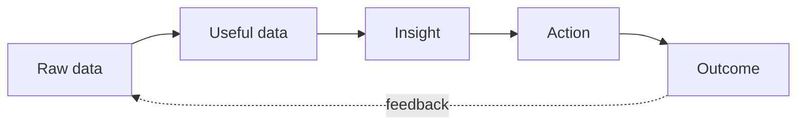
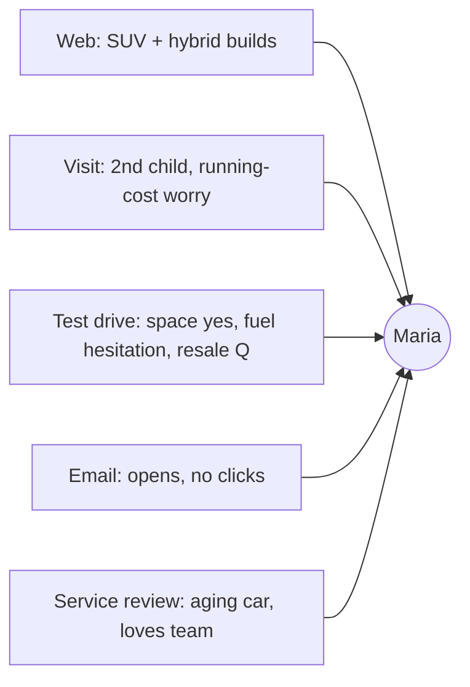
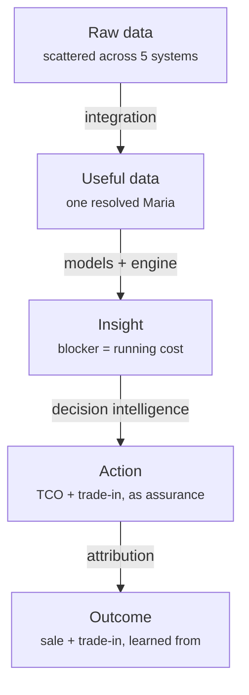

# From Raw Data to a Decision: A Dealership Scenario

Every claim in these docs comes down to one motion: **raw data → useful data →
insight → action → outcome.** This article walks that motion end to end, with a
single concrete dealership scenario, so the abstract pillars become something you
can picture happening on a Tuesday afternoon.

## The four transformations

| Stage | What it is | What it takes |
|---|---|---|
| **Raw data** | Everything that happened, unstructured and scattered | Capture (kiosks, iPads, systems) |
| **Useful data** | The same events, unified and resolved per customer | [Customer Integration](../customer-integration.md) |
| **Insight** | A grounded, tailored finding that implies a decision | [Insights Engine](../insights-engine.md) + [Behaviour Models](../behaviour-models.md) |
| **Action** | A specific, measured next-best-action | [Decision Intelligence](../decision-making.md) |

## The scenario: meet "Maria"

### 1 · Raw data (what actually happened)

Over six weeks, Maria generates signal nobody is joining up:

- Browses the dealership site three evenings, lingering on a mid-size SUV and a
  hybrid trim; configures a build but doesn't submit.
- Walks in on a Saturday. A greeter with an **iPad** checks her in; she mentions
  she has "a second kid on the way" and is "worried about running costs."
- Test-drives the SUV. The salesperson's notes (dictated into the iPad): *"liked
  space, hesitated on fuel, asked about resale."*
- Opens two follow-up emails but clicks neither offer.
- Leaves a 4-star service review on her *current, aging* car two weeks later:
  *"love the team, car's getting tired."*

Today, those five things live in five systems and tell no one a story.

### 2 · Useful data (unified and resolved)

AutoAgentAI's [integration layer](../customer-integration.md) resolves all five to
**one customer, Maria**, on-prem:

Now it's not five fragments — it's a person with a trajectory.

### 3 · Insight (grounded and tailored)

The [behaviour models](../behaviour-models.md) and
[insights engine](../insights-engine.md) read the unified picture and surface a
*custom insight*, not a generic metric:

!!! quote "Insight"
    **Maria is a high-propensity hybrid-SUV buyer whose single blocker is running
    cost, and whose current car is near end-of-life.** Customers matching this
    pattern (growing family + fuel hesitation + aging trade-in + service loyalty)
    convert at well-above-average rates **when shown a total-cost-of-ownership
    comparison and a trade-in value up front** — and churn to a competitor when left
    to a generic follow-up.
    **Evidence:** her web/visit/drive/review signals + the dealership's own history
    of similar customers. **Confidence:** high. **Expected impact:** one incremental
    hybrid sale + a trade-in.

No salesperson assembled this. It was impossible for one to (see
[Why Salespeople Can't Capture This Data](why-salespeople-cant-capture-this.md)).

### 4 · Action (a specific next-best-action)

[Decision Intelligence](../decision-making.md) turns the insight into a concrete,
guardrailed action — not a vague "follow up":

- **Next-best-action:** a personalized follow-up that leads with a **total
  cost-of-ownership** comparison (addressing the exact blocker) *and* an up-front
  **trade-in estimate** for her aging car.
- **Routed to** her salesperson's iPad with the reasoning and talking points, framed
  as *assurance*, not pressure (see
  [Reinventing the Salesperson's Role](reinventing-the-salesperson.md)).
- **Guardrails:** within contact-frequency limits and her consent; a human sends it.

### 5 · Outcome (measured, and fed back)

The action is tracked against a holdout. Maria books a second drive, trades in, and
buys the hybrid. The **outcome feeds back**: the models learn that this pattern +
this action worked, sharpening the next recommendation — and, in aggregate, this
signal can flow to the OEM (see
[Closing the Loop to the OEM](automotive-data-closing-the-loop.md)).

## Why each stage needs the system

Remove any stage and the value collapses: raw data with no integration is noise;
integrated data with no insight is a nicer database; an insight with no action is a
chart nobody acts on; an action with no measured outcome never improves. The agent's
job is to run this whole motion, continuously, for **every** customer at once.

!!! note "Illustrative"
    "Maria" and the numbers are an illustration of the mechanism, not a case study or
    a performance claim.
