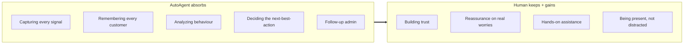

# Reinventing the Salesperson's Role

AutoAgentAI changes what a car salesperson is *for*. The parts of the job that make
customers brace — the pressure, the information asymmetry, the chase — are exactly
the parts the agent absorbs. What's left is the part customers actually want:
**a knowledgeable human offering assurance and assistance.**

!!! abstract "The shift in one line"
    From *persuading people who feel outgunned* to *helping people who feel
    understood.* The agent handles capture, memory, and analysis; the human handles
    trust, reassurance, and care.

## What the job is today — and why it's adversarial

The traditional model puts the salesperson and the customer on opposite sides:

- The salesperson holds information the customer doesn't (cost, margin, what's
  flexible), creating an **asymmetry customers can feel**.
- Their incentive is to close *now*, which reads as **pressure**.
- They must *remember and chase* — juggling dozens of prospects from memory and
  sticky notes, inevitably letting people fall through the cracks.
- Much of their day is **data-entry and follow-up admin**, not helping anyone.

Customers show up defensive because the structure *makes* it adversarial. That
defensiveness is bad for everyone, including the salesperson's close rate.

## What the agent takes off their plate

The agent never forgets a customer, never loses a note, and quietly tells the
salesperson *who needs what, and why, right now* — on their
[iPad](../deployment/on-prem-ai-hardware.md#interfaces-kiosks-and-ipads). The
salesperson walks up already knowing Maria is worried about running costs, so they
can **lead with the answer to her actual concern** instead of a pitch.

## From closer to concierge

| Dimension | Traditional salesperson | AutoAgentAI-enabled host |
|---|---|---|
| **Stance** | Persuade / close | Assure / assist |
| **Information** | Asymmetry (they know more) | Shared (customer feels informed) |
| **Memory** | Human, lossy | Agent-backed, complete |
| **Time spent** | Admin, chasing, guessing | Present with the customer |
| **What the customer feels** | Pressured, defensive | Understood, helped |
| **Incentive felt** | "Sell me something" | "Help me decide well" |

The role becomes closer to a **concierge or trusted advisor**: the person who makes
a big, anxious purchase feel calm and well-handled. That is a *better* job — more
human, less burnout, and, not incidentally, it converts better, because people buy
from people they trust.

## "Replace some salespeople" — honestly

It's fair to be direct: when one agent captures, remembers, and analyzes what used
to take a floor of people chasing and guessing, a dealership **needs fewer people
doing that low-value work.** But the framing matters:

- The work that disappears is the **admin, the chasing, and the guessing** — the
  parts nobody enjoyed and nobody was good at at scale.
- The work that remains and grows is the **human assurance** — which the agent
  can't do and customers value most.
- The net effect is a **smaller team of better-supported people doing higher-value
  work**, each one amplified by the agent, each customer getting more attention, not
  less.

!!! quote "The reframe"
    The agent doesn't replace the salesperson with a machine. It replaces the
    *adversarial, admin-heavy* salesperson with a *supported, trusted host* — and
    lets fewer of them serve more customers, better.

## Why this is good for the customer, too

Buying a car is one of the most stressful consumer purchases there is. An
experience where:

- the person helping you already understands your situation,
- isn't pressuring you because the "closing" machinery runs quietly in the
  background,
- and can answer your real worry with real numbers,

…is simply a better experience. The agent's job is to make the human in front of the
customer **more human**, not to remove them. See the mechanism in
[From Raw Data to a Decision](raw-data-to-action.md).
