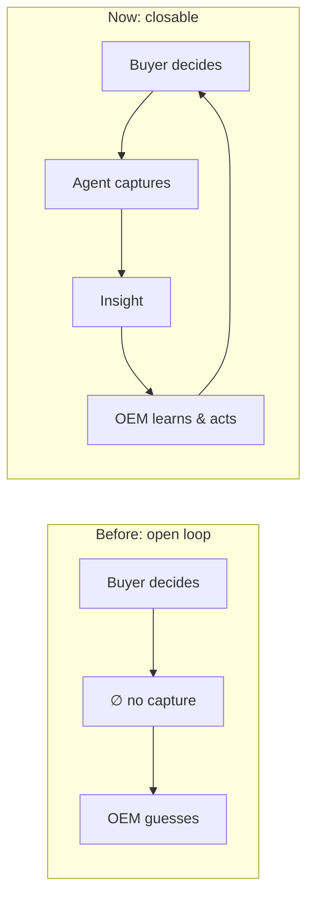
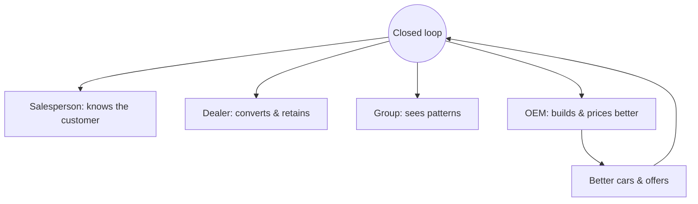

# The Closed Loop: Impossible Before, Ubiquitous Elsewhere

Closing the loop — from a buyer's real decision behaviour back to the people who make
the cars — was not just *hard* before. It was **impossible**. The pieces didn't
exist. Now they do, all at once, and that's the opening. This article is about why it
couldn't be done, why it can be now, how valuable closed loops are in general, and
how other industries already prove it (including the clumsy attempts automotive has
made so far).

!!! abstract "The arc"
    Every great data business is a closed loop: observe → learn → act → observe
    better. Automotive's buyer-decision loop stayed open because no tool could close
    it. The tools finally exist — so the last great open loop is closable.

## Why it was impossible before

Four things all had to be true at once, and until recently none were:

| Requirement | Why it was missing |
|---|---|
| **Capture at the point of decision** | No human could capture it ([here's why](why-salespeople-cant-capture-this.md)); no system was in all channels |
| **Make sense of messy, human signal** | Reading intent from notes, hesitation, behaviour needed AI that didn't exist affordably |
| **Do it privately** | This is PII-heavy; moving it to the cloud was a non-starter — and local models weren't good enough ([now they are](../deployment/local-models-are-enough.md)) |
| **Act and feed back autonomously** | Required agentic orchestration that's only just matured |

Miss any one and the loop stays open. For decades, all four were missing. The loop
wasn't closed because it *couldn't* be.

## Why it's possible now

The same four requirements, flipped:

1. **Kiosks + iPads in every channel** capture decision behaviour as a by-product of
   being useful ([On-Prem AI & Hardware](../deployment/on-prem-ai-hardware.md)).
2. **Agentic AI** reads the messy human signal and reasons over it.
3. **Open local models** make it private and affordable — the data never leaves.
4. **The agent acts and feeds back** continuously, closing the loop end to end.

For the first time, all four are true together. That simultaneity *is* the
opportunity.

## Closed loops are how every data giant wins

This pattern isn't exotic — it's the engine behind the most valuable companies in
the world. They all close a behaviour → action → better-behaviour loop:

| Industry / player | The closed loop they run |
|---|---|
| **Streaming** | What you watch → recommendations → you watch more → better recommendations |
| **E-commerce** | What you browse/buy → personalization → more conversion → sharper model |
| **Social / ads** | Engagement → feed & ad targeting → more engagement → more data |
| **Search** | Clicks → ranking → better results → more clicks |
| **Rideshare / delivery** | Demand signal → pricing & dispatch → smoother service → more demand |

In each, the loop compounds: more data → better action → more data. The winners
aren't the ones with the fanciest model; they're the ones who **closed the loop** on
valuable behaviour first. Automotive's buyer-decision loop is one of the last big
ones still open.

## Automotive's clumsy attempts so far

The industry *knows* it wants this data — its attempts to get it show the hunger and
the failure:

| Attempt | Why it falls short |
|---|---|
| **Feedback surveys (often with prizes)** | Low response, self-selected, after the fact, memory-distorted; a prize bribes a form, it doesn't capture the decision |
| **"How was your visit?" emails / CSI scores** | Measure satisfaction, not intent; gameable; miss the people who walked |
| **Mystery shoppers** | A tiny, artificial sample |
| **Focus groups & clinics** | Expensive, infrequent, not the real buying population |
| **Inferring from sales figures** | Lagging, and silent on *why* — especially on the sales you *lost* |

Every one of these is a workaround for not being able to capture the real thing at
the moment it happens. They're proof the demand is there — and proof the problem was
unsolved. A survey with a prize draw is what you do when you *can't* close the loop.
AutoAgentAI is what you do when you can.

## The ubiquity value

Because the same captured data is valuable at **every** level — salesperson, dealer,
group, and OEM ([How Valuable This Data Is](how-valuable-this-data-is.md)) — closing
this loop isn't one feature for one user. It's an upgrade to the whole chain at once:

!!! quote "The possibility"
    Every industry that closed its behaviour loop was transformed by it. Automotive
    couldn't — until now. The possibilities aren't incremental: a continuously
    learning chain from the showroom floor to the factory, where what buyers actually
    want reaches the people who decide what gets built. That loop was impossible
    yesterday and is buildable today. That's the opportunity in one sentence.
