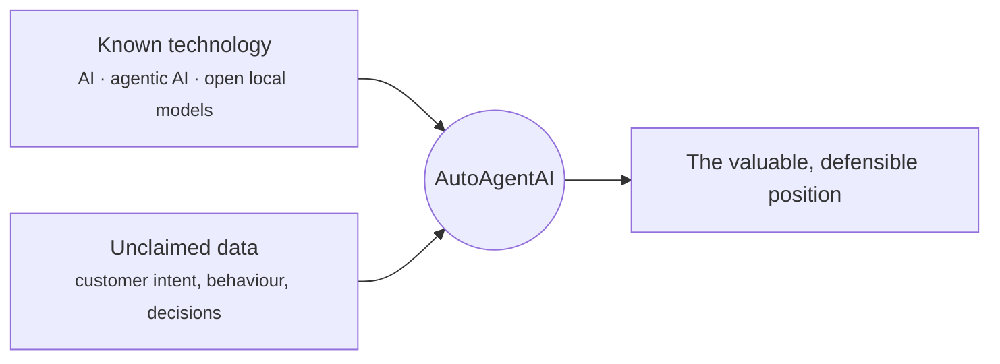
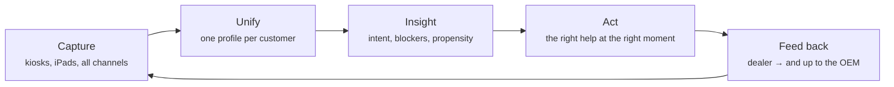

# Capturing the Car Industry's Most Valuable Data

We are not inventing a new kind of AI. Everyone has heard of AI agents; everyone is
building them; agentic AI is not a secret. What's different is **where we point it.**
We are in the automotive industry, and we are using the current advances in AI,
agentic AI, and open-source local models to do one specific thing nobody has done
well: **capture and use the single most valuable data in the entire car industry —
the customer's real intent, behaviour, and decision-making.**

!!! abstract "The one idea"
    The technology is ordinary. The *target* is extraordinary. An AI agent — the
    thing everyone already knows about — aimed at the richest, least-captured data in
    autos, running privately on local models, closes a gap the whole industry has.

## The tech is known; the application is the edge

- **AI agents** — widely understood, widely available.
- **Agentic patterns** (planning, tools, memory) — mature and documented.
- **Open-source local models** — now good enough to run the whole thing privately
  on-prem ([Local Models Are Enough](../deployment/local-models-are-enough.md)).

Individually, none of that is a moat. **Pointed at the car industry's customer
behaviour data, and able to actually capture it, it is.** The moat is the data and
the capture, not the model.

## Why *this* data is the prize

The automotive purchase is unusually rich in signal and unusually high in stakes:

- It's a **big, considered, emotional** purchase — months of deliberation, lots of
  behaviour to read.
- It's **multi-channel** — web, showroom, test drive, service, finance.
- It recurs over a **long relationship** — purchase, service, trade-in, repurchase.
- The **decisions are high-value** — a single correctly-read customer is a car sold,
  a trade-in captured, a service relationship kept.

And almost none of it is captured today, because capturing it was impossible for the
people on the floor ([Why Salespeople Can't Capture This Data](why-salespeople-cant-capture-this.md)).
The most valuable data in the industry is sitting in plain sight, uncollected.

## What "capture and utilize" means here

We don't just *store* the data — the whole point is the loop from capture to use:

Everyone can run an agent. Few can *capture this data at all*, and fewer can turn it
into the right action and feed it back up the chain (see
[Closing the Loop to the OEM](automotive-data-closing-the-loop.md)). That capture →
use → feedback loop is the product.

## Why now, and why us

| Enabler | Why it matters |
|---|---|
| **Agentic AI matured** | An "analyst that never sleeps" is finally buildable |
| **Local models got good enough** | The whole thing runs privately on-prem — essential for this PII-heavy data |
| **Privacy pressure rising** | Sovereign, on-prem capture is the only durable way to hold this data ([Privacy](../deployment/privacy-pii-future-proofing.md)) |
| **We're in the industry** | We know where the signal is, how dealerships work, and what the OEM wants |

!!! quote "The positioning"
    "AI agent" is table stakes. **An AI agent that captures and uses the most
    valuable, least-captured data in the car industry — privately, on local models,
    all the way up to the OEM** — is the thing. We're not selling the hammer;
    we're the ones who found the gold it's for.

Next: just how valuable that data is — [How Valuable This Data Is](how-valuable-this-data-is.md).
