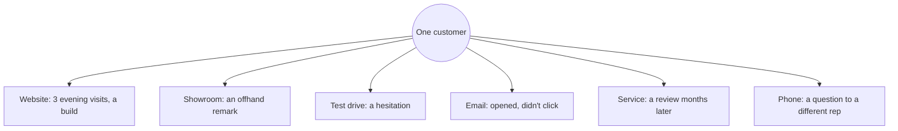
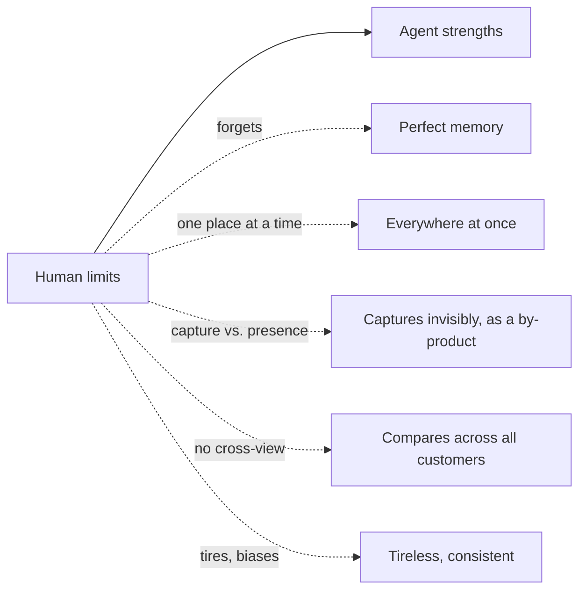

# Why Salespeople Can't Capture This Data

The data AutoAgentAI works with isn't hard for a salesperson to capture by
accident — it's **impossible** for them to capture by design. Not because they're
not good at their jobs, but because the task is structurally beyond what any human
can do. This matters, because it's the reason this data has stayed uncaptured and
therefore *unexploited* across the whole industry.

!!! abstract "The core point"
    You cannot ask a human to be a perfect, tireless, unbiased sensor and analyst
    across hundreds of customers and thousands of tiny signals. The data isn't
    missing because people are lazy — it's missing because capturing it is not a
    human-scale task.

## The signals are tiny, constant, and multi-channel

A single customer throws off signal across channels no salesperson can see at once:

The salesperson sees, at most, the showroom slice — and only while standing there.
The evening web visits, the email behaviour, the service review, the call to a
different rep: invisible to them. The story only exists when **all** of it is joined,
and no human is in all those places.

## Six reasons it's impossible for a human

| # | Barrier | Why it defeats a person |
|---|---|---|
| 1 | **Volume** | Hundreds of active prospects, each generating signal daily. No memory holds that. |
| 2 | **Simultaneity** | Signals arrive across web, phone, email, showroom, service — at the same time, in different places. |
| 3 | **Subtlety** | "Worried about resale," a 20-second extra pause on a trim — the signal is in the small stuff. |
| 4 | **Recall decay** | Even captured, human memory of a conversation is gone or distorted within days. |
| 5 | **The capture tax** | Logging a detail means *not* being present with the customer. Doing the job well means *not* recording it. |
| 6 | **No cross-customer view** | A human can't compare this customer to the 400 similar ones to know what usually works. |

Barrier 5 is the cruel one: **the act of capturing data competes with the act of
selling.** Every note typed is attention taken off the human in front of you. So the
best salespeople, rightly, *don't* capture — they stay present — and the data
evaporates.

## What actually happens today

- A fraction of interactions get a terse CRM note, written later, from memory.
- The note captures what the rep *thought mattered*, not the full signal.
- Web, email, service, and call data sit in other systems, unjoined.
- When the rep leaves, their "book" of customer knowledge walks out the door.
- Cross-customer patterns — the most valuable thing — are never computed at all.

The result: the industry sits on an ocean of the most valuable behavioural data
there is (see [The Most Valuable Data in Autos](the-most-valuable-data-in-autos.md))
and captures a thimble of it, badly.

## Why only an agent can

An autonomous agent is the only thing shaped right for this task, because it is
everything a human can't be here:

- It is **in every channel at once** — web, kiosk, iPad, email, service — because it
  *is* the system those run on.
- It **captures as a by-product** of being useful (the
  [kiosks and iPads](../deployment/on-prem-ai-hardware.md#interfaces-kiosks-and-ipads)
  log rich signal just by serving the customer), so capture no longer competes with
  presence.
- It **never forgets** and **never leaves** — institutional memory that doesn't walk
  out the door.
- It **compares across every customer** to know what works.

!!! quote "The unlock"
    The data was never capturable by people — so it was never captured, so its value
    was never unlocked. An agent makes the impossible task routine. That's the whole
    opportunity: not doing what salespeople do a bit better, but doing the thing they
    *structurally could not do at all.*

This is why the role shifts to assurance and assistance
([Reinventing the Salesperson's Role](reinventing-the-salesperson.md)) — the human
does the human part, and the agent does the part no human ever could.
