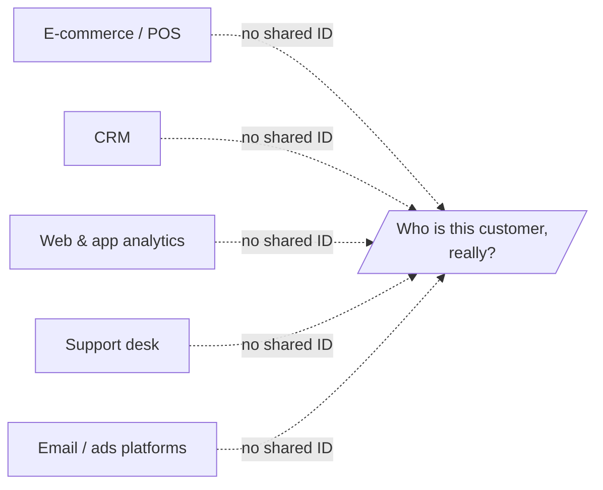

# Problem & Motivation

## The problem

Businesses generate more customer signal than ever, and act on less of it than
they think. Three gaps recur:

### 1. Data is fragmented

Customer information lives in separate systems that rarely agree on who a customer
is or what they did:

The same person is a row in the POS, a contact in the CRM, an anonymous device in
analytics, and a ticket in support — with nothing tying them together.

### 2. Insight is reactive and manual

Even where data is joined, the standard tool is a **dashboard**: it shows metrics
and waits for a human to notice something, form a hypothesis, and go dig. The
questions asked are limited by the analyst's time and imagination, and most
patterns are never looked for.

### 3. Insight rarely becomes a decision

The last mile is the hardest. A chart showing churn rising does not, by itself,
tell anyone *which* customers, *why*, or *what to do*. The translation from
"interesting finding" to "specific action taken" is where most value leaks out.

## Why now

- **Agentic AI is viable.** LLM-based agents can plan, use tools, query data, and
  explain their reasoning — making an "analyst that works on its own" realistic
  rather than aspirational.
- **Customer data is more connectable.** Modern data stacks (warehouses, CDPs,
  event pipelines) make integration tractable where it used to be bespoke.
- **Expectations have shifted.** Customers expect relevance; businesses expect
  their tools to be proactive. Static reporting no longer meets either.

## Who it's for

| Audience | Pain today | What AutoAgentAI gives them |
|---|---|---|
| **Growth / marketing teams** | Segments go stale; targeting is coarse | Live, behaviour-based segments and next-best-action per customer |
| **Product teams** | Hard to see how usage predicts retention or expansion | Behaviour models linking usage to outcomes |
| **Customer success / retention** | Churn noticed too late | Early, explained churn risk with recommended saves |
| **Analysts / data teams** | Flooded with ad-hoc requests | An agent that handles the routine slicing and surfaces the non-obvious |
| **Leadership** | Decisions made on gut or lagging reports | Decision-ready insight tied to measurable outcomes |

## The core bet

> If an autonomous agent **integrates** the customer data, **continuously**
> generates insight tailored to the business, and frames every insight as a
> **decision**, then businesses act on far more of their signal — and the gap
> between "data we have" and "decisions we make" closes.

This is the thesis the rest of the documentation builds on. The
[architecture](architecture.md) is the structure designed to deliver it; the
[use cases](use-cases.md) make it concrete.
