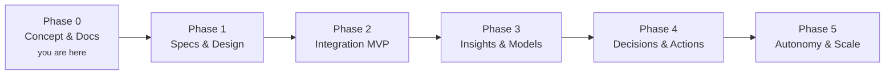

# Roadmap

A phased path from **concept and documentation** (where the project is now) to a
validated product. Phases are about *proving the next risky thing*, not calendar
dates.

## Phase 0 — Concept & documentation ✅ *(current)*

**Goal:** get the thinking organized, shared, and hosted.

- [x] Repository created, documentation-first.
- [x] Concept, vision, and the five-pillar architecture documented.
- [x] Shared vocabulary ([glossary](concepts-glossary.md)).
- [x] Diagrams (Mermaid) + [figure specs](assets/diagrams/FIGURE_SPECS.md) for richer visuals.
- [x] Hosted docs site (GitHub Pages via MkDocs Material).

## Phase 1 — Specifications & design

**Goal:** turn concept into buildable specs. De-risk the *what* and *how*.

- [ ] Choose the beachhead use case and target customer segment.
- [ ] Physical data model + schema for the unified profile.
- [ ] Technical architecture decision records (stack, model providers, datastores).
- [ ] Define v1 action catalog and default guardrails.
- [ ] Spec the first behaviour models (likely RFM, churn/purchase propensity,
      behavioural clustering).
- [ ] API and integration contracts for the first 1–2 data sources.

→ Specs live under [Specifications](specs/index.md).

## Phase 2 — Customer Integration MVP

**Goal:** prove we can integrate real customer data and resolve identities well.

- [ ] Ingest from the first sources (e.g. commerce + one behavioural source).
- [ ] Identity resolution with confidence scoring.
- [ ] Unified profiles materialized and queryable.
- [ ] Consent/privacy enforcement baseline.

## Phase 3 — Insights & behaviour models

**Goal:** prove we can produce genuinely useful, grounded insights.

- [ ] First behaviour models trained and serving.
- [ ] Insights Engine producing validated, ranked insights.
- [ ] Plain-language "ask the agent" (pull mode).
- [ ] Human evaluation: are the insights trusted and non-obvious?

## Phase 4 — Decisions & actions

**Goal:** close the last mile — insight → action → measured outcome.

- [ ] Next-best-action and action catalog.
- [ ] First outbound action integration (e.g. trigger a campaign / create a task).
- [ ] Experimentation + attribution framework (holdouts).
- [ ] Human-in-the-loop approval console.

## Phase 5 — Autonomy & scale

**Goal:** earn and expand autonomy; make it robust and multi-tenant.

- [ ] Graduated autonomy levels with per-action guardrails.
- [ ] Continuous agent loop with memory and learning from outcomes.
- [ ] Observability, audit, and safety hardening.
- [ ] Scale to more sources, more customers, more businesses.

## Risks to retire (in rough priority)

| Risk | Phase it's tested |
|---|---|
| Can we integrate & resolve messy real data? | 2 |
| Are the insights actually useful and trusted? | 3 |
| Does acting on them move the metric (causally)? | 4 |
| Can the agent act autonomously *and* safely? | 5 |
| Does it generalize across businesses? | 5 |

!!! note "This roadmap is a draft"
    Sequencing and scope will change as specs are written and the beachhead use
    case is chosen. Phase 0's job is to make that conversation possible.
