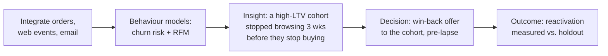
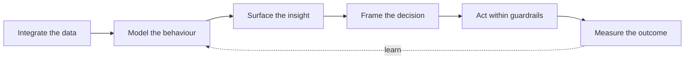

# Use Cases

Concrete scenarios that make the pillars tangible. Each follows the same arc:
**integrate → model → insight → decision → outcome**.

## 1. E-commerce: rescue a silently churning cohort

**Situation.** An online retailer's repeat-purchase rate is slipping, but the
headline numbers look fine.

- **Insight:** customers who were worth the most show a 3-week engagement drop
  *before* their purchases stop — a leading indicator no dashboard was tracking.
- **Decision:** the agent proposes a targeted, time-boxed win-back to exactly those
  accounts, before they lapse.
- **Outcome:** reactivation rate measured against a holdout; what works feeds the
  next round.

## 2. SaaS: turn usage signals into expansion

**Situation.** A B2B SaaS wants to grow existing accounts but can't tell which are
ready.

- **Integrate:** product usage events + CRM + billing.
- **Model:** feature-adoption depth, engagement trend, expansion propensity.
- **Insight:** accounts that adopt feature *X* within 30 days expand at 3× the rate;
  a set of current accounts just crossed that threshold.
- **Decision:** flag those accounts to sales with the evidence and a suggested
  expansion play; nudge stalled accounts toward feature *X*.
- **Outcome:** expansion revenue attributed to flagged vs. unflagged accounts.

## 3. Subscription / DTC: reduce involuntary and voluntary churn

- **Integrate:** subscriptions, payments, support, app usage.
- **Model:** churn risk split by *cause* (price, dunning/failed payment,
  dissatisfaction, low usage).
- **Insight:** a third of churn is involuntary (failed payments), not a loyalty
  problem at all.
- **Decision:** route involuntary-risk customers to smart dunning; route
  dissatisfaction-risk to a save play; leave content customers alone.
- **Outcome:** churn reduction by cause, each measured separately.

## 4. Retail / omnichannel: unify online + in-store, then personalize

- **Integrate:** POS + e-commerce + loyalty, resolved to one customer.
- **Model:** cross-channel behaviour, product affinity, channel preference.
- **Insight:** customers who shop both channels are worth 2× single-channel ones,
  and a large single-channel group looks ready to cross over.
- **Decision:** encourage the cross-over with channel-appropriate, affinity-based
  offers.
- **Outcome:** cross-channel conversion and LTV lift.

## 5. Plain-language investigation (pull mode)

Not every use case is automated. An operator can simply ask:

> *"Why did conversion drop last week?"*

The agent perceives the question, queries the integrated data, compares cohorts,
and returns a **grounded insight** — "the drop is isolated to mobile users on
channel Z after the checkout change on the 12th; desktop is flat" — with the
evidence and a suggested next step. Same machinery, human-initiated.

---

## Pattern across all use cases

The value isn't any single model or chart — it's an autonomous loop that keeps
finding the non-obvious and tying it to a decision, across the whole customer base,
continuously.

!!! tip "These are illustrative"
    Numbers and scenarios here are examples to convey the shape of the product, not
    claims or benchmarks. Real validation comes with the [roadmap](roadmap.md).
